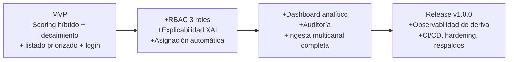

# PRD y Definición de MVP: Sistema Inteligente de Lead Scoring

**Proyecto:** Sistema Inteligente de Lead Scoring
**Empresa:** PluriOne S.A. de C.V. (Develop Talent & Technology)
**Autor:** Rosales Castillo Sebastián — Ingeniería en Sistemas Computacionales
**No. de Control:** 223107211
**Periodo:** 2026-2 (01/08/2026 – 31/12/2026)

---

## 1. Resumen Ejecutivo

PluriOne calificaba a sus prospectos comerciales de forma manual y por orden de llegada (FIFO), sin un criterio cuantitativo que distinguiera a un director de TI con presupuesto asignado de un contacto sin poder de decisión. El resultado medido: hasta 48 horas de demora en contactar prospectos "calientes", más del 60% del tiempo comercial invertido en contactos de bajo valor, y una tasa de conversión final por debajo del 3.5%.

Este documento define **qué problema resuelve el producto, para quién, con qué alcance mínimo viable (MVP) y qué queda fuera de ese primer corte**, separando la visión completa del sistema (ya materializada como Release v1.0.0) del subconjunto mínimo que habría bastado para validar la hipótesis central: *que un score cuantitativo y explicable prioriza mejor la cartera que el criterio manual del ejecutivo*.

---

## 2. Problema y Oportunidad

| Síntoma observado | Causa raíz |
| :--- | :--- |
| Prospectos "HOT" contactados hasta 48h tarde | No existe priorización automática; el CRM atiende por orden de llegada |
| 60%+ del esfuerzo comercial en leads de bajo valor | No hay filtro cuantitativo de fit (cargo, industria, tamaño de empresa) |
| Conversión final < 3.5% | El interés de un prospecto decae con el tiempo y el sistema actual no lo modela |
| Ejecutivos desconfían de "cajas negras" | Ninguna herramienta evaluada explica por qué un lead vale más que otro |

**Oportunidad:** construir un motor de scoring propio, barato de operar (costo $0 en desarrollo, sin licencias SaaS de $150–300 USD/usuario/mes) y ajustado al modelo B2B específico de PluriOne (staffing tecnológico y consultoría), en vez de adoptar una plataforma comercial genérica de caja negra (HubSpot Enterprise, Salesforce Einstein).

---

## 3. Objetivo del Producto

Priorizar automáticamente la cartera de prospectos de PluriOne mediante un score de 0–100, explicado en lenguaje natural, que combine señales de negocio (fit + comportamiento) con un componente de machine learning, y que penalice el paso del tiempo sin interacción.

**Hipótesis a validar:** un score híbrido (reglas + ML) ordena mejor la cartera que el criterio manual actual, y el componente de ML aporta una mejora medible sobre el heurístico solo.

> Nota honesta de resultado (no se escribe así en un PRD de arranque, pero sí en la retrospectiva): sobre datos sintéticos, el heurístico solo alcanza 0.9110 ROC-AUC y el híbrido con ML 0.9524 — un aporte real de **+0.041**. La hipótesis se confirma, pero el margen es modesto y debe reportarse así, no como "la IA lo resuelve todo".

---

## 4. Usuarios y Personas

| Persona | Rol | Necesidad principal |
| :--- | :--- | :--- |
| **Ejecutivo Comercial** | Trabaja su propia cartera | Ver primero a quién llamar hoy, y por qué |
| **Líder de Ventas** | Supervisa el equipo completo | Ver la cartera completa, reasignar, medir campañas |
| **Administrador TI** | Gestiona cuentas y seguridad | Alta/baja de usuarios, auditoría, nada de datos comerciales por defecto |
| **Sistema CRM externo** | Actor no humano | Enviar leads nuevos vía webhook sin fricción |

---

## 5. Alcance del MVP

### 5.1 Principio de corte

El MVP es el conjunto mínimo de piezas sin el cual **no se puede probar la hipótesis** (RF-02, RF-03, RF-04) más la superficie mínima para que un ejecutivo real la use sin intervención técnica (RF-08 reducido) y la puerta de entrada de datos (RF-01 reducido). Todo lo demás — aunque valioso — se documenta como *fuera del MVP* aunque ya esté construido en el release actual.

### 5.2 Dentro del MVP

| # | Funcionalidad | RF relacionado | Por qué es mínimo indispensable |
| :-- | :--- | :--- | :--- |
| 1 | Alta manual y por webhook de un prospecto | RF-01 (parcial) | Sin datos no hay score que calcular |
| 2 | Cálculo de score híbrido (ML 60% + heurístico 40%) | RF-02 | Es el núcleo de la hipótesis |
| 3 | Decaimiento temporal del score | RF-03 | Sin esto el score no distingue un lead frío de uno reciente; es la queja #1 del diagnóstico |
| 4 | Categorización HOT / WARM / COLD | RF-04 | Es la salida mínima que un ejecutivo necesita para decidir a quién llamar |
| 5 | Listado de prospectos ordenado por score, con login | RF-08 (reducido a una vista, sin dashboards analíticos) | Sin interfaz no hay forma de que el ejecutivo consuma el score |
| 6 | Autenticación y un solo rol operativo | RNF-04 (reducido) | Requisito mínimo de seguridad para no exponer datos de clientes |

### 5.3 Explícitamente fuera del MVP (aunque ya estén en el release v1.0.0)

| Funcionalidad | RF relacionado | Por qué se difiere |
| :--- | :--- | :--- |
| Explicabilidad en lenguaje natural (motor XAI) | RF-06 | Mejora la confianza del usuario, pero el score ya es usable sin justificación textual |
| Asignación automática a ejecutivo disponible | RF-07 | Optimización de reparto; con 1-2 ejecutivos se puede asignar a mano |
| Dashboard analítico completo (embudo MQL→SAL→SQL, campañas) | RF-08 (completo) | Es reporting gerencial, no bloquea la operación diaria |
| RBAC de 3 roles + bitácora de auditoría completa | RNF-04 (completo), RNF-05 | Necesario para producción multiusuario, no para validar la hipótesis con un piloto acotado |
| Monitoreo de deriva del modelo, reentrenamiento con feedback | — | Solo tiene sentido con volumen de datos reales acumulado, que no existe el día 1 |
| Métricas Prometheus, CI/CD, hardening de contenedores, respaldos con prueba de restauración | RNF operativos | Son requisitos de un sistema en producción sostenida, no de una prueba de concepto |

### 5.4 Criterio de éxito del MVP

- Un ejecutivo puede abrir la vista de prospectos y ver, sin ayuda técnica, cuáles son HOT hoy.
- Un lead sin interacción durante 14+ días baja visiblemente de categoría (decaimiento funcionando).
- El score se recalcula en menos de 150 ms por prospecto (RNF-01).
- Comparado contra un mes de asignación manual, el equipo contacta primero a los prospectos que terminan cerrando venta con mayor frecuencia que con el método FIFO anterior.

---

## 6. Fuera de alcance (para cualquier versión de este proyecto de estadía)

- Integración en vivo con Azure ML / Azure OpenAI (el sistema queda "Azure-ready" por variables de entorno, pero la estadía se ejecuta 100% local/mock, RNF-02 y RNF-03).
- Migración de datos reales de clientes de PluriOne (todo el desarrollo usa datos sintéticos por el convenio de confidencialidad vigente).
- Automatización de canales de captación que PluriOne no tiene hoy (formulario web propio): el receptor queda implementado y desactivado hasta que exista ese formulario.

---

## 7. Requerimientos No Funcionales que aplican desde el MVP

| ID | Criterio |
| :--- | :--- |
| RNF-01 | Inferencia de scoring < 150 ms por prospecto |
| RNF-02 | Cero costo de operación en desarrollo (SQLite/Docker Compose local) |
| RNF-04 (mínimo) | La aplicación exige login; no hay acceso anónimo a datos de prospectos |

---

## 8. Roadmap: de MVP a Release v1.0.0

Esto coincide con los bloques de estadía ya ejecutados (ver [Reporte 01](reportes/Reporte_01_Deteccion_de_Necesidades_y_Requerimientos.md), sección 4): el MVP corresponde al Bloque 2 (Core Backend + ML Pipeline), y los Bloques 3–4 (Frontend completo, QA, DevOps, seguridad) son las capas que llevan el MVP hasta la Release v1.0.0 documentada en el [README](../README.md) y la [Memoria Técnica](Memoria_Tecnica_Final_Lead_Scoring.md).

---

## 9. Riesgos y Supuestos

| Riesgo / Supuesto | Impacto | Mitigación |
| :--- | :--- | :--- |
| El aporte del ML sobre el heurístico es pequeño (+0.041 AUC) medido en datos sintéticos | El sínodo puede cuestionar si "vale la pena" el ML | Reportarlo con transparencia (Capítulo 12 de la Memoria); el valor del producto no depende solo del ML, sino del decaimiento temporal y la explicabilidad |
| No hay datos reales de PluriOne para entrenar/validar | El desempeño en producción puede diferir del medido | Se documenta explícitamente en README y Memoria que las métricas son sobre datos sintéticos; el pipeline valida integridad, no rendimiento comercial |
| PluriOne no tiene formulario web propio | RF-01 completo queda parcialmente sin uso real al día de hoy | Se implementa el receptor pero se deja desactivado, sin bloquear el resto del sistema |

---

## 10. Referencias del proyecto

- [README.md](../README.md) — arquitectura y guía de despliegue de la Release v1.0.0
- [Reporte 01 — Detección de Necesidades](reportes/Reporte_01_Deteccion_de_Necesidades_y_Requerimientos.md)
- [Reporte 02 — Propuesta Técnica y Estrategia de Lead Scoring](reportes/Reporte_02_Propuesta_Tecnica_y_Estrategia_de_Lead_Scoring.md)
- [Reporte 04 — Planificación Operativa y Gestión Scrum](reportes/Reporte_04_Planificacion_Operativa_y_Gestion_Scrum_del_Proyecto.md)
- [Memoria Técnica Final](Memoria_Tecnica_Final_Lead_Scoring.md)
