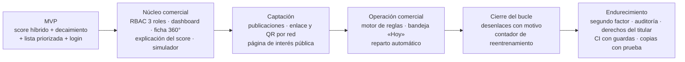

# MVP — Sistema Inteligente de Lead Scoring

**Empresa:** PluriOne S.A. de C.V. · **Residente:** Rosales Castillo Sebastián (223107211) · **Periodo:** 2026-2 (31/08/2026 – 29/01/2027)

Complementa al [PRD](PRD.md): aquí se define **el mínimo que valida la hipótesis** y cómo ese mínimo creció hasta el producto entregado.

---

## 1. Hipótesis que el MVP debe validar

> Un score cuantitativo y explicable, que penaliza el paso del tiempo, prioriza la cartera mejor que el orden de llegada; y el componente de Machine Learning aporta una mejora medible sobre las reglas de negocio solas.

## 2. Corte del MVP

El MVP son las piezas **sin las cuales la hipótesis no se puede probar** más la superficie mínima para que un asesor la use sin ayuda técnica.

| # | Funcionalidad del MVP | RF | Por qué es indispensable |
| :-: | :--- | :-: | :--- |
| 1 | Alta de un prospecto (manual y webhook firmado) | RF-01 | Sin datos no hay nada que puntuar |
| 2 | Score híbrido 60/40 (ML + heurístico ICP) | RF-02 | Es el núcleo de la hipótesis |
| 3 | Decaimiento temporal (vida media 14 días) | RF-03 | Sin él un lead frío puntúa igual que uno reciente |
| 4 | Categorías HOT / WARM / COLD | RF-04 | Es lo que el asesor necesita para decidir a quién llamar |
| 5 | Lista de prospectos ordenada por score, con inicio de sesión | RF-13 (mínimo) | Sin pantalla no hay quien consuma el score |
| 6 | Pipeline de entrenamiento reproducible con umbrales de publicación | — | Sin él no hay manera de medir el aporte del modelo |

**Criterios de aceptación del MVP**

- Un asesor abre la lista y ve, sin ayuda, qué prospectos son HOT hoy.
- Un lead sin interacción durante 14 días baja de puntuación de forma visible.
- La inferencia individual tarda < 150 ms.
- El entrenamiento se niega a publicar un modelo con ROC-AUC < 0,82 o con aporte < 0,01 por el límite inferior del intervalo.

## 3. De MVP a producto entregado

| Etapa | Qué añadió | Cuándo (según el historial del repositorio) |
| :--- | :--- | :--- |
| MVP | Score, decaimiento, categorías, lista, pipeline | Bloques 1–2 de la estadía (septiembre) |
| Núcleo comercial | RBAC, dashboard, ficha 360°, XAI, simulador | Bloque 3 |
| Captación | Publicaciones, QR, página pública | Capítulos 25–27 (22–23-09-2026) |
| Operación comercial | Motor de reglas, «Hoy», campana, reparto automático | Capítulos 28 y 46 |
| Cierre del bucle | Desenlaces y contador | Capítulo 30 (24-09-2026) |
| Endurecimiento | Segundo factor, accesibilidad, cadena de suministro, CI | Capítulos 33–45 |

## 4. Fuera del MVP (y por qué)

| Funcionalidad | Por qué se difiere |
| :--- | :--- |
| Publicaciones, QR, página pública | Amplía el alta de datos; el score ya es usable con altas manuales y webhook |
| Motor de reglas y bandeja «Hoy» | Mejora la operación diaria, no la validez del score |
| Reparto automático | Con pocos asesores se asigna a mano |
| Desenlaces y reentrenamiento | Solo sirve cuando hay conversiones reales acumuladas |
| Segundo factor, auditoría completa, derechos del titular | Necesarios para producción multiusuario, no para validar la hipótesis |
| CI con guardas, métricas, respaldos | Requisitos de operación sostenida |

## 5. Resultado de la validación

| Pregunta | Respuesta | Evidencia |
| :--- | :--- | :--- |
| ¿El modelo ordena bien? | Sí, sobre datos sintéticos: ROC-AUC 0,9469 | `ml_pipeline/models/metrics.json` |
| ¿Aporta sobre las reglas solas? | Sí: **+0,0519**, IC 95 % [+0,0296, +0,0761] — el intervalo no toca el cero | Mismo archivo; bootstrap pareado de 2000 remuestreos |
| ¿Es reproducible? | Sí: el artefacto sale idéntico byte a byte (SHA-256 `98ed8bd1…`) entrenando de cero | `docs/Para_Quien_Revisa_Este_Repositorio.md` §1 |
| ¿Mejora la conversión real de PluriOne? | **No se ha podido medir**: no hay desenlaces reales todavía | El panel de desenlaces cuenta cuántos faltan (mínimo 200, 50 por clase) |

**Qué falta para validar de verdad:** operar el sistema con prospectos reales hasta reunir el mínimo de cierres, reentrenar con ellos y comparar contra el heurístico. Es tiempo y conversiones, no código.
