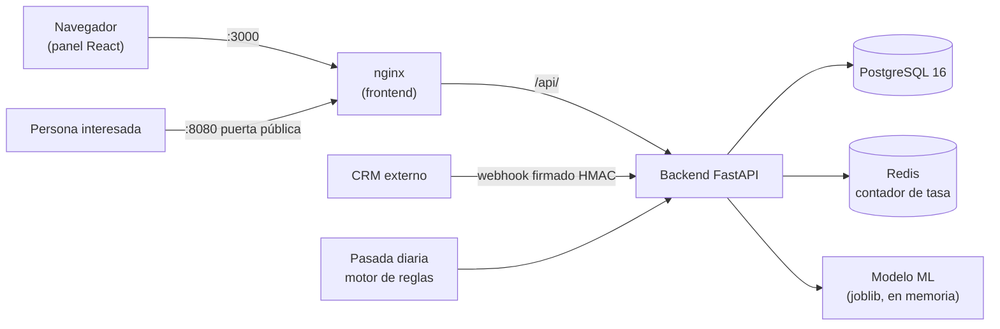

# Manual técnico — Sistema Inteligente de Lead Scoring

**Audiencia:** desarrolladores y personal de TI que mantendrán el sistema.
**Estado:** congelación definitiva desde el 06-10-2026. Antes de modificar nada, leer [`AGENTS.md`](../../AGENTS.md).

---

## 1. Visión general



| Capa | Tecnología |
| :--- | :--- |
| Backend | Python 3.13, FastAPI, Pydantic v2, SQLAlchemy 2.0, Alembic |
| Base de datos | PostgreSQL 16 (pila) · SQLite en memoria (pruebas) |
| ML | scikit-learn: `GradientBoostingClassifier` + `CalibratedClassifierCV` isotónica |
| Frontend | React + Vite, Vitest + Testing Library, ESLint con reglas de accesibilidad |
| Operación | Docker Compose (6 servicios), nginx, Redis, respaldos con perfil `respaldo` |
| CI | GitHub Actions, 10 trabajos |

## 2. Estructura del repositorio

```
backend/app/core/          reglas y vocabulario compartido; NO importa de app.models
backend/app/models/        esquema (entities.py); importa de core, nunca al revés
backend/app/services/      la lógica; un servicio puede importar a otro
backend/app/api/v1/        endpoints; no deciden alcance de cartera
backend/app/repositories/  el alcance de cartera vive aquí, no en cada endpoint
backend/alembic/           18 migraciones; nada crea tablas al vuelo
backend/tests/             la suite (2093 pruebas)
frontend/src/              cliente; services/ reglas compartidas; pruebas/ las derivadas
ml_pipeline/               entrenamiento, deriva, registro, realimentación
devops/                    pila.py (único arranque), compose, init_db.sql, respaldos
scripts/                   guardas del CI, ensayo de la demo, preparación de pruebas
docs/                      guías, reportes (44) y memoria técnica compilada
```

La dependencia entre ML y backend va en un solo sentido: el heurístico compartido vive en `backend/app/core/scoring_rules.py` y el pipeline lo importa. Así el modelo se entrena y se evalúa con **la misma** definición de «buen prospecto».

## 3. Algoritmo de scoring

$$S_{final} = 0{,}60 \cdot S_{ML} + 0{,}40 \cdot S_{heur} \cdot \gamma(\Delta t), \qquad \gamma(\Delta t) = 0{,}5^{\Delta t/14}$$

- `S_ML`: probabilidad calibrada del modelo. Si el artefacto no está o su huella no cuadra con `ML_MODEL_SHA256`, el adaptador **cae al heurístico** (diseño deliberado: la instancia sigue sirviendo).
- `S_heur`: reglas ICP (cargo, sector, tamaño, canal, actividad). Una sola definición en `core/scoring_rules.py`; `test_scoring_parity.py` compara las dos rutas de cálculo.
- Categorías: HOT ≥ 75 · WARM [45, 75) · COLD < 45.
- Cada puntuación guarda la **instantánea del vector** y la versión del motor (`v1.0.0-hybrid+ml:<huella8>` o `…+heuristico`).
- Ausencias (p. ej. facturación en LinkedIn) se tratan como **ausencia**, nunca como cero; un canal desconocido es neutro.

### Pipeline de ML (`ml_pipeline/src/`)

| Módulo | Función |
| :--- | :--- |
| `synthetic_generator.py` | Genera los prospectos sintéticos (semilla 42) |
| `feature_engineering.py` | Vector de variables v2 |
| `train_model.py` | Entrena, evalúa con bootstrap y **se niega a publicar** si ROC-AUC < 0,82 o el límite inferior del aporte < 0,01 |
| `baselines.py` | Líneas base: azar, una sola columna, heurístico |
| `model_registry.py` | Registro con procedencia; el perfil de referencia queda atado por huella al artefacto |
| `drift_monitor.py` | Deriva por PSI; **informa, no falla** |
| `feedback_dataset.py` | Dataset de desenlaces reales; se niega por debajo de 200 casos / 50 por clase |

## 4. API REST (`/api/v1`)

| Prefijo | Función | Quién |
| :--- | :--- | :--- |
| `/auth` | Login, refresco (rotado), logout, cambio de contraseña, segundo factor | Público / sesión |
| `/leads` | CRUD de prospectos, actividades, cierre, recálculo masivo | Según rol y cartera |
| `/scoring` | Predicción puntual y simulador | Sesión |
| `/crm` | Webhook firmado (HMAC-SHA256, ±300 s, idempotente) | Sistema externo |
| `/integraciones` | Recepción de LinkedIn y formulario web | Sistema externo |
| `/eventos-sin-asociar` | Bandeja de eventos sin ficha | Líder / admin |
| `/analytics` | KPIs, embudo, campañas | Según rol |
| `/audit` | Bitácora de auditoría (solo lectura) | Solo `System_Admin` |
| `/users`, `/sales-reps` | Cuentas y equipo comercial | Admin / líder |
| `/campaigns` | Campañas de captación | Alta/edición: líder y admin |
| `/publicaciones` | Publicaciones, difusión, QR, informes, comparativa | Líder / admin |
| `/interes` | Página pública de interés (única ruta sin sesión que escribe) | Público |
| `/agenda` | Tareas del día y avisos | Sesión |
| `/desenlaces` | Panel de desenlaces y contador | Líder / admin |

Fuera de `/api/v1`: `/health` (consulta real a la base; 503 si no responde) y `/metrics` (Prometheus, protegido por `METRICS_TOKEN`; 404 en producción si no hay testigo). `/docs` y `/redoc` se desactivan con `ENVIRONMENT=production`.

## 5. Modelo de datos

Entidades principales (`backend/app/models/entities.py`): usuarios y sesiones/familias de refresco, prospectos, actividades, historial de puntuaciones (con plazo de conservación de 12 meses por defecto), campañas, publicaciones y visitas, tareas y avisos, desenlaces, trabajos de recálculo con arriendo (`lease_until`, índice único sobre `lease_key`), bitácora de auditoría, entregas de webhook (idempotencia) y registro de modelos. Cualquier cambio de esquema exige una migración Alembic con su reversión probada; en producción el backend **verifica** que la base esté en la última revisión y aborta si no.

## 6. Seguridad

| Aspecto | Implementación |
| :--- | :--- |
| Autenticación | JWT HS256 firmado por el backend: access token de 15 min en memoria del navegador; refresco de 7 días en cookie `HttpOnly`, `SameSite=Strict`, ruta `/api/v1/auth` |
| Rotación | Cada refresco consume el token; reutilizar uno ya consumido revoca la **familia entera** (ventana de gracia de 10 s para dos pestañas) |
| Revocación inmediata | `token_version` en la cuenta: logout, cambio de rol y reset cierran todas las sesiones |
| Contraseñas | bcrypt directo; 12–72 bytes; lista local de contraseñas filtradas **y** consulta por rango a un servicio público |
| Segundo factor | TOTP para administración; el secreto se **deriva y no se guarda** |
| Autorización | RBAC (3 roles) y alcance de cartera aplicado en el repositorio: el alcance es argumento obligatorio, un endpoint que lo olvide falla con `TypeError` |
| Límites de tasa | login 10/min · predict 60/min · webhook 120/min por IP, con Redis compartido entre workers |
| Página pública | Campo trampa, límite por IP y por publicación, misma respuesta (202) exista o no el correo |
| Webhook | HMAC-SHA256 sobre `<timestamp>.<cuerpo>`, ventana ±300 s, 409 ante reenvío idéntico, 200 idempotente ante reintento |
| Contenedores | `read_only`, `cap_drop: ALL`, `no-new-privileges`, techos de CPU/memoria, PostgreSQL sin puerto publicado |
| Cadena de suministro | Dependencias fijadas con hash, `pip-audit`, `npm audit`, Trivy, SBOM CycloneDX, imágenes fijadas por huella |
| Secretos | Fuera del repositorio (`~/.plurione/pila.env`); el lanzador se niega a arrancar con un `.env` dentro del árbol |

## 7. Pruebas y calidad

| Qué | Cifra |
| :--- | :--- |
| Pruebas del servidor | 2093 (2 omitidas), cobertura 99,11 % contando ramas |
| Pruebas del cliente | 748 en 45 archivos; suelos de cobertura independientes por métrica |
| CI | 10 trabajos, 61 controles de configuración peligrosa, 7 guardas de propiedades |
| Accesibilidad | WCAG 2.1 AA en las nueve pantallas, medido con `axe-core` |

```bash
python -m pytest backend/tests -q                  # nunca dos pytest a la vez
python -m pytest backend/tests -q --cov=backend/app --cov-fail-under=99.1
ruff check backend/ scripts/
cd frontend && npx vitest run && npx eslint src && npm run build
python scripts/guarda_del_ci.py                    # veredicto de la última ejecución del CI
```

**Reglas aprendidas:** la suite corre sobre SQLite, así que lo exclusivo de PostgreSQL (`FOR UPDATE`) se comprueba sobre la **sentencia compilada** contra ese dialecto; una guarda que nadie ha puesto en rojo no es una guarda (arnés de reintroducción); las listas de inventario se derivan del código, no se escriben a mano.

## 8. Operación

| Tarea | Cómo |
| :--- | :--- |
| Arranque | Siempre `python devops/pila.py …` (ver [Guía de instalación](Guia_de_Instalacion.md)) |
| Migraciones | `docker compose run --rm migrate` (automático al arrancar; el backend espera su éxito) |
| Registro | JSON, una línea por evento, con `request_id` en cada renglón y en la cabecera `X-Request-ID` |
| Métricas | `/metrics`; los contadores de proceso son por worker; los de base son exactos |
| Deriva del modelo | `python ml_pipeline/src/drift_monitor.py` (en la pila, desde el contenedor) |
| Recálculo masivo | Un turno a la vez: el segundo recibe 409; si el proceso muere el arriendo vence y el trabajo queda `FAILED` |
| Respaldos | Volcado verificado con huella; **la prueba de restauración** compara filas tabla por tabla |
| Restauración | Exige el archivo exacto y `CONFIRMO_SOBRESCRIBIR=si`; usa `--single-transaction` |

**Límites que conviene tener escritos:** las copias viven en el mismo disco (no protegen de su pérdida); la prueba de restauración demuestra que el archivo sirve, no que se pueda reconstruir el servicio en otra máquina.

## 9. Diagnóstico rápido

| Síntoma | Qué mirar |
| :--- | :--- |
| Puntúa pero parece «sin modelo» | `curl /health` → `ml_model_loaded`; en `false`, entrenar (paso 1 de la instalación) |
| Panel con 502 tras reconstruir solo el backend | Reiniciar el frontend (nginx resuelve el upstream al arrancar) |
| Dos servicios «unhealthy» que funcionan | Revisar la sonda de salud, no el servicio |
| Se comporta como una versión vieja | Reconstruir con `--build`; una imagen vieja arranca igual |
| 401/403 repentinos para todos | `SECRET_KEY` cambió entre arranques |
| Todo verde en local y rojo en el CI | Teclear `python scripts/guarda_del_ci.py`: de los defectos de octubre ninguno vino de un cambio del árbol |

## 10. Documentos de referencia

- [`AGENTS.md`](../../AGENTS.md) — reglas del repositorio.
- [`Congelacion_y_Trabajo_Futuro.md`](../Congelacion_y_Trabajo_Futuro.md) — qué está abierto, cerrado y descartado.
- [`Si_Algo_Falla.md`](../Si_Algo_Falla.md) — operación sin programar.
- [`Memoria_Tecnica_Final_Lead_Scoring.md`](../Memoria_Tecnica_Final_Lead_Scoring.md) — los 44 reportes compilados.
