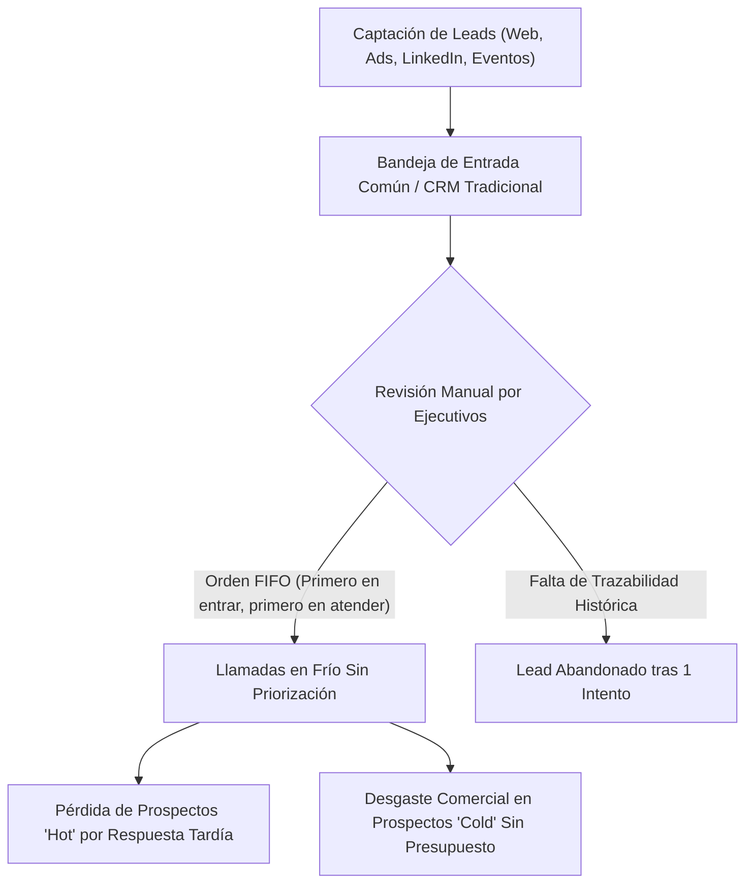
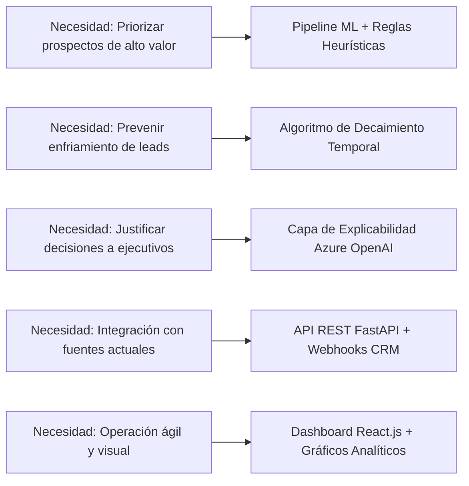
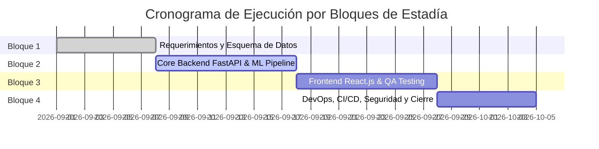

# Reporte Técnico 01: Detección de Necesidades y Requerimientos del Sistema Inteligente de Lead Scoring

**Proyecto:** Sistema Inteligente de Lead Scoring basado en Inteligencia Artificial y Machine Learning  
**Empresa:** PluriOne S.A. de C.V. (Develop Talent & Technology)  
**Autor:** Alumno de Estadía Profesional - Ingeniería en Sistemas Computacionales  
**Fecha:** Septiembre 2026  
**Fase de Estadía:** 1. Detección de Necesidades y Requerimientos  

---

## 1. Objetivo de la Fase
El objetivo primordial de esta fase inicial fue realizar una investigación exhaustiva y un levantamiento técnico de los procesos de prospección comercial y reclutamiento de talento en **PluriOne S.A. de C.V.**, con el propósito de identificar cuellos de botella operativos, fuga de prospectos con alto potencial y la falta de un mecanismo cuantitativo automatizado para priorizar leads. A partir de este diagnóstico, me propuse formalizar la especificación de requerimientos de software (funcionales y no funcionales), delimitar el alcance del sistema y diseñar la matriz de trazabilidad de necesidades que guiará el desarrollo de la solución integral de Lead Scoring con costo cero ($0 USD) en desarrollo local.

---

## 2. Qué se Realizó (Módulos, Análisis y Requerimientos)

### 2.1. Diagnóstico del Proceso Comercial Actual en PluriOne
Analicé el flujo tradicional con el que la fuerza de ventas y el equipo de consultoría de PluriOne gestionan las oportunidades comerciales entrantes de staffing tecnológico y consultoría corporativa:



Identifiqué los siguientes dolores operativos críticos:
1. **Atención por orden de llegada (FIFO)**: Los ejecutivos comerciales atienden prospectos sin distinguir su intención de compra o presupuesto, demorando hasta 48 horas en contactar a directivos (CTOs, Directores de TI) que requerían atención inmediata en menos de 15 minutos.
2. **Desgaste en prospectos de baja calidad**: Más del 60% del tiempo de prospección se destinaba a contactos estudiantiles o sin perfil de decisión, reduciendo el ratio de conversión final a menos del 3.5%.
3. **Pérdida de tracción temporal**: Un prospecto que demostró gran interés hace dos semanas pierde relevancia rápidamente si no es contactado, pero el CRM actual no penalizaba el paso del tiempo sobre el interés del lead.

---

### 2.2. Especificación Formal de Requerimientos Funcionales (RF)

Estructuré y documenté los requerimientos funcionales del sistema bajo la norma IEEE 830:

| ID | Requerimiento Funcional | Descripción Técnica | Prioridad |
| :--- | :--- | :--- | :--- |
| **RF-01** | **Ingesta Multicanal de Leads** | El sistema debe disponer de endpoints API REST y Webhooks asíncronos para recibir prospectos desde formularios web, campañas digitales, LinkedIn y plataformas CRM externas. | Alta |
| **RF-02** | **Cálculo de Scoring Híbrido** | El motor debe calcular una puntuación compuesta de 0 a 100 basada en la probabilidad de Machine Learning (60%) y reglas heurísticas de negocio (40%). | Crítica |
| **RF-03** | **Decaimiento Temporal Dinámico** | El sistema debe aplicar una función de atenuación exponencial sobre la puntuación del lead en función de los días de inactividad ($e^{-\lambda \Delta t}$). | Alta |
| **RF-04** | **Categorización Automática de Leads** | Clasificación instantánea del prospecto en tres cuadrantes operativos: `HOT` ($\ge 75$), `WARM` ($[45, 75)$) y `COLD` ($< 45$). | Crítica |
| **RF-05** | **Registro y Ponderación de Eventos** | Captura continua de actividades (visitas a páginas clave, descargas de whitepapers, asistencia a webinars, solicitudes de demo) con pesos específicos. | Alta |
| **RF-06** | **Explicabilidad en Lenguaje Natural** | Generación de síntesis ejecutiva y justificación del score asignado mediante servicios de IA (adaptadores Azure OpenAI / Mock local). | Media |
| **RF-07** | **Asignación Inteligente a Ejecutivos** | Enrutamiento automático de prospectos `HOT` hacia el ejecutivo comercial disponible con capacidad activa. | Media |
| **RF-08** | **Dashboard Analítico y Pipeline** | Interfaz web interactiva que presente la distribución de prospectos, embudo de conversión (MQL $\rightarrow$ SAL $\rightarrow$ SQL) y métricas de desempeño. | Alta |

---

### 2.3. Especificación de Requerimientos No Funcionales (RNF)

| ID | Categoría | Criterio de Aceptación |
| :--- | :--- | :--- |
| **RNF-01** | **Rendimiento y Latencia** | El endpoint de inferencia y scoring sincrónico debe responder en menos de $150\,\text{ms}$ para peticiones individuales. |
| **RNF-02** | **Costo de Operación Local** | El entorno de desarrollo y pruebas debe operar al 100% de manera local a **costo cero ($0 USD)** mediante SQLite / Docker Compose y adaptadores Mock. |
| **RNF-03** | **Portabilidad Cloud (Azure Ready)** | La arquitectura debe desacoplarse mediante variables de entorno para que el paso a producción en Azure (PostgreSQL Flexible Server, Azure ML, Azure OpenAI) no exija alterar el código base. |
| **RNF-04** | **Seguridad y Control de Acceso** | Simulación de RBAC alineada a Microsoft Entra ID con roles claramente definidos (`Admin`, `Sales_Lead`, `Commercial_Executive`). |
| **RNF-05** | **Trazabilidad y Auditoría** | Cada recalificación debe persistir un registro histórico inmutable en `score_histories` con los pesos y factores utilizados. |

> **Nota del capítulo 20.** «Inmutable» se mantiene, pero no «para siempre». Desde la Fase 14
> el detalle de cada recalificación se conserva sin cambios durante el plazo de retención
> (`SCORE_HISTORY_RETENTION_MONTHS`, 12 meses completos por defecto); pasado ese plazo se
> resume por prospecto y mes y se borra. Nunca se purgan la puntuación de entrada ni la
> vigente de cada prospecto. Un historial sin plazo de datos de personas no era un requisito
> de trazabilidad: era una retención indefinida que nadie había decidido (§20.3).

---

### 2.4. Matriz de Trazabilidad de Necesidades vs. Componentes Técnicos



---

## 3. Justificación Técnica
Opté por formalizar los requerimientos bajo una arquitectura orientada al dominio comercial de PluriOne en lugar de adquirir una solución de software comercial empaquetada (SaaS comercial como HubSpot Enterprise o Salesforce Einstein Lead Scoring) por las siguientes razones de ingeniería:
1. **Alineación exacta al modelo B2B de PluriOne**: Las plataformas comerciales estándar aplican algoritmos de caja negra que no consideran adecuadamente las particularidades del mercado mexicano de reclutamiento de talento TI y perfiles ejecutivos.
2. **Independencia tecnológica y costo cero en desarrollo**: Los SaaS comerciales implican costos recurrentes de licenciamiento por usuario ($150 - $300 USD mensuales por ejecutivo). Diseñar nuestra solución propietaria en Python/FastAPI con persistencia relacional garantiza propiedad intelectual total y flexibilidad para iterar.
3. **Transparencia y Explicabilidad (XAI)**: Los comerciales rechazan herramientas que solo arrojan un número sin justificación. Nuestro requerimiento RF-06 garantiza que cada calificación entregue motivos claros ("Cargo C-Level", "Visita reiterada a página de precios").

---

## 4. Metodología y Arquitectura Aplicada
Para la gestión de este proyecto de estadía profesional seleccioné el marco ágil **Scrum** adaptado a un ciclo iterativo de 4 bloques de entrega continua:



### Casos de Uso Principales del Sistema
Diseñé el diagrama de casos de uso UML que modela las interacciones entre los actores del negocio:

```mermaid
usecaseDiagram
    actor "Ejecutivo Comercial" as EC
    actor "Líder de Ventas" as LV
    actor "Sistema CRM Externo" as CRM
    
    package "Sistema Inteligente de Lead Scoring" {
        usecase "Consultar Prospectos Priorizados (HOT/WARM)" as UC1
        usecase "Visualizar Explicación del Score (IA)" as UC2
        usecase "Registrar Nueva Actividad del Prospecto" as UC3
        usecase "Ingestar Lead vía Webhook" as UC4
        usecase "Recalcular Score en Lote con Decaimiento" as UC5
        usecase "Monitorear KPIs y Conversión de Campañas" as UC6
    }
    
    EC --> UC1
    EC --> UC2
    EC --> UC3
    CRM --> UC4
    LV --> UC5
    LV --> UC6
```

---

## 5. Retos Técnicos Superados y Evidencia Funcional

### Reto 1: Definición de Criterios Objetivos de Calificación
**Problema:** El equipo comercial utilizaba apreciaciones subjetivas ("este cliente parece interesado").  
**Solución:** Diseñé una taxonomía cuantitativa dividida en tres dimensiones:
- **Atributos Firmográficos (Fit):** Cargo del contacto, tamaño de la empresa, industria prioritaria, facturación estimada.
- **Comportamiento Digital (Engagement):** Frecuencia de aperturas de correo, clics en propuestas, descargas técnicas y solicitudes directas de demostración.
- **Vector de Frescura (Recency):** Tiempo transcurrido desde la última interacción relevante.

### Reto 2: Compatibilidad de Ingesta Heterogénea
**Problema:** Los prospectos provienen de múltiples orígenes (campañas en redes sociales, mensajes de LinkedIn y WhatsApp, llamadas telefónicas, referidos y alta manual del asesor). PluriOne no dispone hoy de formularios web; el receptor para ellos queda preparado y desactivado hasta que exista uno.  
**Solución:** Especifiqué un esquema canónico de datos en JSON con campos estándar obligatorios y un contenedor de metadatos flexibles (`raw_metadata`) para admitir cualquier carga útil sin romper el modelo relacional.

### Evidencia de Requerimientos Consolidados
Como evidencia funcional de esta fase, consolidé la estructura de configuración y la definición canónica del lead en el archivo de especificación del proyecto, sentando las bases sólidas para el diseño matemático del algoritmo y la modelación de la base de datos.
