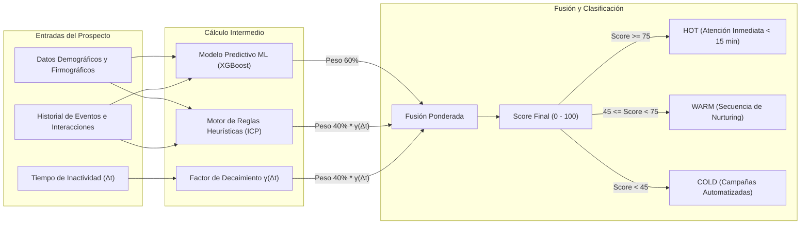
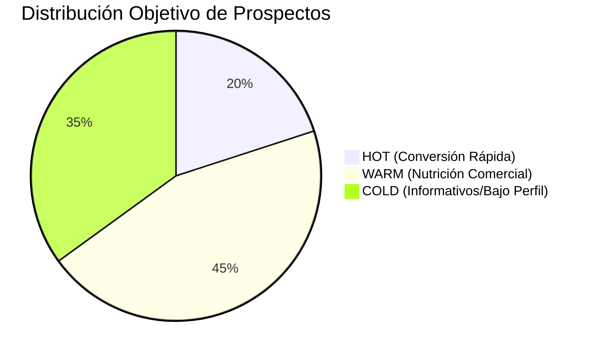
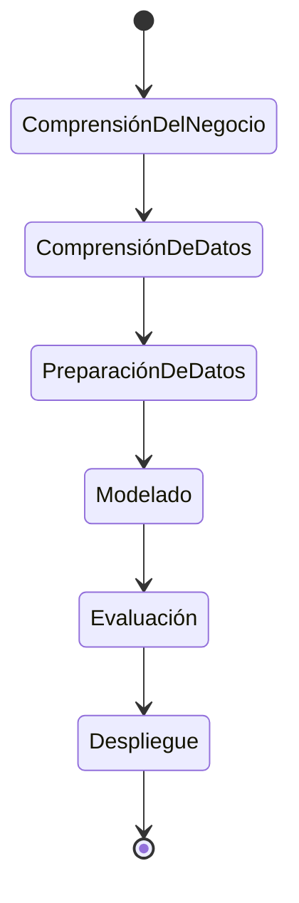

# Reporte Técnico 02: Propuesta Técnica y Estrategia de Lead Scoring Híbrido

**Proyecto:** Sistema Inteligente de Lead Scoring basado en Inteligencia Artificial y Machine Learning  
**Empresa:** PluriOne S.A. de C.V. (Develop Talent & Technology)  
**Autor:** Alumno de Estadía Profesional - Ingeniería en Sistemas Computacionales  
**Fecha:** Septiembre 2026  
**Fase de Estadía:** 2. Propuesta Técnica, Estrategia de Scoring y Definición de KPIs  

---

## 1. Objetivo de la Fase
El objetivo principal de esta fase fue formalizar el modelo matemático, metodológico y conceptual del **Sistema de Lead Scoring Híbrido**. Diseñé una formulación algorítmica integral que combina la capacidad predictiva de modelos de Machine Learning (clasificación supervisada) con un sistema de reglas heurísticas empresariales basadas en el perfil de cliente ideal (ICP - *Ideal Customer Profile*) de PluriOne, integrando además una función de atenuación o decaimiento temporal exponencial para reflejar la pérdida de vigencia del interés de los prospectos. Asimismo, establecí los indicadores clave de rendimiento (KPIs) para evaluar el impacto en la tasa de conversión comercial.

---

## 2. Qué se Realizó (Diseño Matemático y Estrategia de Scoring)

### 2.1. Formulación del Algoritmo de Scoring Híbrido
Diseñé el algoritmo de calificación compuesto $S_{\text{final}} \in [0, 100]$, el cual se define formalmente como:

$$S_{\text{final}} = \min\left(100, \max\left(0, w_{\text{ml}} \cdot S_{\text{ML}} + w_{\text{heur}} \cdot S_{\text{Heurístico}} \cdot \gamma(\Delta t)\right)\right)$$

Donde:
- $w_{\text{ml}} = 0.60$: Peso ponderado asignado al modelo predictivo de Machine Learning.
- $w_{\text{heur}} = 0.40$: Peso ponderado asignado al motor heurístico de ajuste comercial.
- $S_{\text{ML}} = P(\text{Conversión} \mid \vec{X}) \times 100$: Puntuación probabilística calculada por el modelo supervisado (XGBoost / Random Forest).
- $S_{\text{Heurístico}} \in [0, 100]$: Puntuación calculada por reglas de compatibilidad de perfil y eventos digitales.
- $\gamma(\Delta t)$: Factor de decaimiento temporal exponencial en función de los días de inactividad $\Delta t$.

---

### 2.2. Modelo Matemático de Decaimiento Temporal Exponencial
Para evitar que prospectos que interactuaron hace meses mantengan una calificación artificialmente alta, modelé la atenuación temporal basada en el concepto de **vida media de interés** ($t_{1/2} = 14 \text{ días}$):

$$\gamma(\Delta t) = e^{-\lambda \Delta t} = 2^{-\frac{\Delta t}{t_{1/2}}} = \left(\frac{1}{2}\right)^{\frac{\Delta t}{14}}$$

Donde la constante de decaimiento es $\lambda = \frac{\ln(2)}{14} \approx 0.04951 \text{ día}^{-1}$.

#### Comportamiento del Factor de Decaimiento en el Tiempo:
| Días Inactivo ($\Delta t$) | Factor de Decaimiento $\gamma(\Delta t)$ | Impacto en $S_{\text{Heurístico}} = 80$ |
| :---: | :---: | :---: |
| **0 días (Activo hoy)** | $1.000$ ($100\%$) | $80.0$ pts |
| **7 días (1 semana)** | $0.707$ ($70.7\%$) | $56.6$ pts |
| **14 días (Vida media)** | $0.500$ ($50.0\%$) | $40.0$ pts |
| **28 días (4 semanas)** | $0.250$ ($25.0\%$) | $20.0$ pts |
| **45 días (>1 mes)** | $0.108$ ($10.8\%$) | $8.6$ pts |

---

### 2.3. Matriz de Ponderación Heurística (Ideal Customer Profile - ICP)

Desarrollé la matriz de asignación de puntos para las reglas determinísticas:

#### A. Ajuste Firmográfico y de Perfil ($P_{\text{fit}}$, Máximo 50 pts):
1. **Cargo / Nivel de Decisión:**
   - C-Level (CEO, CTO, CIO, VP de TI/RH): $+25 \text{ pts}$
   - Director de Área / Gerente Senior: $+18 \text{ pts}$
   - Líder Técnico / Coordinador: $+10 \text{ pts}$
   - Estudiante / Sin cargo corporativo: $0 \text{ pts}$
2. **Industria y Sector Económico:**
   - FinTech, Banca, Software/TI, E-Commerce: $+15 \text{ pts}$
   - Retail, Logística, Salud Corporativa: $+10 \text{ pts}$
   - Otras industrias: $+5 \text{ pts}$
3. **Tamaño de la Empresa:**
   - Corporativo (1000+ empleados): $+10 \text{ pts}$
   - Mediana Grande (201-1000 empleados): $+8 \text{ pts}$
   - Mediana Pequeña (11-200 empleados): $+5 \text{ pts}$
   - Microempresa (1-10 empleados): $+2 \text{ pts}$

#### B. Intención y Comportamiento Digital ($P_{\text{behavior}}$, Máximo 50 pts):
1. Solicitud directa de Demostración o Cotización: $+25 \text{ pts}$
2. Asistencia completa a Webinar técnico: $+15 \text{ pts}$
3. Descarga de Whitepaper o Caso de Éxito: $+10 \text{ pts}$
4. Clic en correo de propuesta comercial: $+8 \text{ pts}$
5. Apertura de correo electrónico de campaña: $+3 \text{ pts}$
6. Visita a página de catálogo/servicios: $+2 \text{ pts}$

---

### 2.4. Definición de KPIs y Métricas de Impacto Comercial
Para evaluar el éxito de la implementación en PluriOne, definí los siguientes indicadores clave:

| KPI Comercial | Definición y Fórmula | Meta Proyectada con el Sistema |
| :--- | :--- | :--- |
| **Tasa de Conversión MQL a SQL** | $\frac{\text{Leads Calificados por Ventas}}{\text{Leads Calificados por Marketing}} \times 100$ | Incrementar de $12\%$ a $\ge 32\%$ |
| **Velocidad de Contacto Lead HOT** | Tiempo transcurrido desde la captura hasta el primer contacto comercial. | Reducir de $36 \text{ hrs}$ a $< 15 \text{ min}$ |
| **Tasa de Cierre (Win Rate)** | $\frac{\text{Oportunidades Ganadas}}{\text{Total de Leads Contactados}} \times 100$ | Incrementar de $3.5\%$ a $\ge 8.5\%$ |
| **Precisión del Modelo (ROC-AUC)** | Área bajo la curva ROC en predicción de conversión. | $\ge 0.82$ |
| **Productividad del Asesor** | Oportunidades comerciales gestionadas por ejecutivo/mes. | Aumento del $40\%$ en tiempo efectivo |

---

## 3. Justificación Técnica
Justifiqué la adopción de un **enfoque híbrido (Machine Learning + Reglas Heurísticas + Decaimiento Temporal)** frente a dos alternativas comunes:

1. **Frente a un modelo basado únicamente en Machine Learning:**
   - *Problema del arranque en frío (Cold Start):* En fases iniciales o con nuevas campañas, el volumen de datos históricos etiquetados puede ser limitado, provocando predicciones inestables o sobreajustadas.
   - *Ventaja del híbrido:* Las reglas heurísticas proveen una base sólida e interpretable desde el día 1, mientras que el modelo de ML refina y descubre patrones sutiles conforme se acumulan datos.
2. **Frente a un sistema basado exclusivamente en Reglas Estáticas (CRMs convencionales):**
   - *Rigidez y obsolescencia:* Las reglas fijas no aprenden de las fluctuaciones del mercado ni capturan relaciones no lineales complejas entre variables.
   - *Falta de decaimiento dinámico:* Los sistemas tradicionales no descuentan puntos con precisión temporal matemática continua.

---

## 4. Metodología y Arquitectura Aplicada
Adopté la metodología **CRISP-DM (Cross-Industry Standard Process for Data Mining)** para guiar la conceptualización del ciclo de datos y scoring:

1. **Comprensión del Negocio:** Alineación con los directivos de PluriOne respecto a las características que definen a un cliente ideal (B2B).
2. **Preparación de Datos:** Normalización de títulos de trabajo (NLP simple/embeddings) y vectorización de variables firmográficas.
3. **Modelado:** Algoritmos supervisados de ensamble de árboles (Gradient Boosting) optimizados para variables tabulares y funciones continuas de decaimiento.
4. **Evaluación:** Validación cruzada estratificada ($k=5$) y análisis de calibración de probabilidades (Brier Score).

---

## 5. Retos Técnicos Superados y Evidencia Funcional

### Reto 1: Evitar Saltos Bruscos o Discontinuidades en el Score
**Problema:** Al restar puntos por inactividad mediante reglas discretas de rangos (ej. "si pasaron 15 días, restar 20 puntos"), se producían caídas abruptas injustificadas en la frontera de los días.  
**Solución:** Implementé la función exponencial suave y continua $\gamma(\Delta t) = e^{-\lambda \Delta t}$, garantizando una degradación natural y matemáticamente predecible.

### Reto 2: Calibración de Probabilidades de Machine Learning
**Problema:** Muchos modelos clasificadores entregan puntuaciones que no corresponden a verdaderas probabilidades de conversión.  
**Solución:** Especifiqué el uso de calibración de probabilidades (`CalibratedClassifierCV` con método isotónico o sigmoid) en el pipeline de Scikit-Learn para asegurar que un score de $0.80$ signifique que 8 de cada 10 prospectos con ese vector de características terminan convirtiendo.

### Evidencia de Validación Matemática
Desarrollé la simulación del comportamiento de puntaje en pruebas de escritorio y verifiqué que prospectos con alto engagement y perfiles ejecutivos alcanzan consistentemente el rango `HOT` ($>75$), mientras que leads inactivos sufren atenuación hacia `WARM` o `COLD` tras 14 días sin actividad, validando la coherencia conceptual del modelo.
