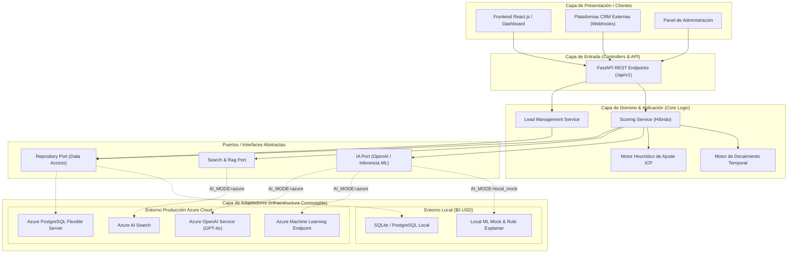
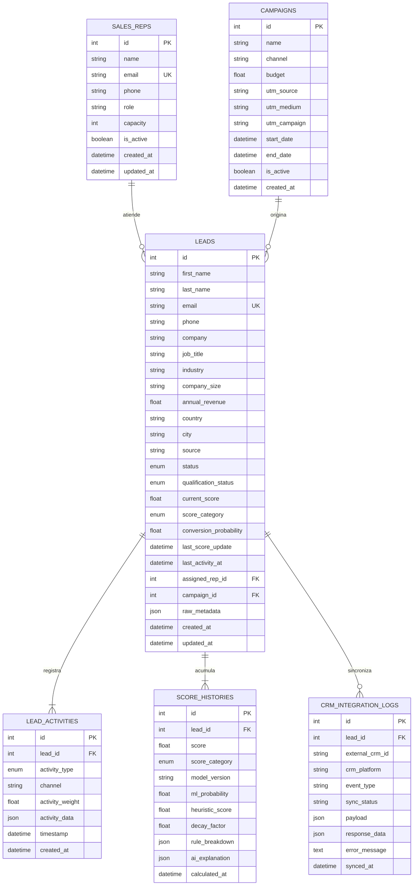

# Reporte Técnico 03: Diseño de Arquitectura Integral, Clean Architecture y Modelo de Datos Relacional

**Proyecto:** Sistema Inteligente de Lead Scoring basado en Inteligencia Artificial y Machine Learning  
**Empresa:** PluriOne S.A. de C.V. (Develop Talent & Technology)  
**Autor:** Alumno de Estadía Profesional - Ingeniería en Sistemas Computacionales  
**Fecha:** Septiembre 2026  
**Fase de Estadía:** 3. Arquitectura Tecnológica Integral y Modelo de Datos Relacional  

---

## 1. Objetivo de la Fase
El objetivo central de esta fase fue concebir, diseñar e implementar la arquitectura integral de software del sistema bajo el paradigma de **Clean Architecture (Arquitectura Limpia / Puertos y Adaptadores)**, garantizando una total independencia entre la lógica de negocio y las tecnologías de infraestructura. Asimismo, me propuse diseñar e implementar el modelo de datos relacional de alta fidelidad en **PostgreSQL / SQLAlchemy**, configurar la orquestación local con **Docker Compose** bajo una estricta directriz de **desarrollo local a costo cero ($0 USD)**, y parametrizar la solución para que pueda conectarse de forma transparente a los servicios administrados de **Microsoft Azure** en producción mediante variables de entorno.

---

## 2. Qué se Realizó (Arquitectura, Componentes y Modelado de Datos)

### 2.1. Estructura de Directorios del Monorepo
Diseñé y construí la estructura de carpetas modular del proyecto para facilitar el mantenimiento colaborativo y la separación de capas:

```
Sistema_Inteligente_Lead_Scoring/
├── backend/                  # Núcleo API REST FastAPI y Lógica de Negocio
│   ├── app/
│   │   ├── core/             # Configuración (Pydantic Settings), DB Engine y Seguridad
│   │   ├── models/           # Entidades ORM relacionales SQLAlchemy
│   │   ├── schemas/          # DTOs y validación de esquemas Pydantic
│   │   ├── repositories/     # Capa de acceso a datos (Repository Pattern)
│   │   ├── services/         # Servicios de negocio, scoring y reglas heurísticas
│   │   ├── adapters/         # Adaptadores (Mock Local $0 vs Azure OpenAI/ML/Search)
│   │   └── api/              # Controladores REST API v1
│   ├── scripts/              # Scripts de inicialización y siembra de datos (seed_data.py)
│   └── requirements.txt      # Dependencias backend y ML
├── frontend/                 # Aplicación cliente en React.js (Dashboard y Visualización)
├── ml_pipeline/              # Modelos, preprocesamiento y entrenamiento ML
│   ├── data/                 # Datasets sintéticos y particiones train/test
│   ├── models/               # Artefactos y pesos serializados de modelos
│   └── src/                  # Pipelines de extracción de features y evaluación
├── devops/                   # Orquestación de contenedores y despliegue
│   ├── docker-compose.yml    # Servicios locales PostgreSQL 16 y PgAdmin
│   └── init_db.sql           # Extensiones y esquemas DDL iniciales
├── docs/                     # Documentación de ingeniería y reportes
│   ├── SILS.pdf              # Especificación general del proyecto
│   └── reportes/             # Suite de 10 reportes técnicos de estadía
├── .env.example              # Plantilla de variables de entorno (Dev $0 / Prod Azure)
├── .env                      # Configuración de ejecución activa
└── .gitignore                # Reglas de exclusión de artefactos y secretos
```

---

### 2.2. Diagrama de Arquitectura Tecnológica y Patrón Puertos y Adaptadores
Implementé la arquitectura bajo el patrón de Puertos y Adaptadores (*Hexagonal Architecture*), asegurando que el dominio central de scoring no dependa de librerías externas ni de servicios de nube específicos:



---

### 2.3. Diagrama Entidad-Relación (ERD) del Modelo Relacional
Diseñé el esquema relacional normalizado en tercera forma normal (3NF) con soporte para metadatos semiestructurados mediante campos JSON/JSONB:



> **Nota (capítulo 21).** `LEAD_ACTIVITIES` ya no es como la dibuja el diagrama. Desde la
> Fase 15 `timestamp` se llama `occurred_at` —cuándo ocurrió, separado de `created_at`—,
> `activity_weight` desapareció porque nadie la leía, y cada fila lleva `source`,
> `external_event_id` (único con la fuente), `verificada`, `direction` y `call_outcome`. Hay
> además una tabla `UNMATCHED_EVENTS`, la bandeja «Sin asociar», sin clave foránea a `LEADS`.

---

### 2.4. Entorno de Orquestación Docker Compose y Persistencia Local
Diseñé el archivo `devops/docker-compose.yml` para desplegar localmente los contenedores de soporte:
1. **Contenedor PostgreSQL 16 Alpine**: Base de datos relacional robusta con extensiones `uuid-ossp` y `pg_trgm`.
2. **Contenedor PgAdmin 4**: Interfaz gráfica web para administración y monitoreo de transacciones.
3. **Mecanismo Dual SQLite / PostgreSQL**: En `app/core/database.py` implementé la conmutación dinámica: si se utiliza SQLite (por ejemplo, para ejecuciones ultrarrápidas de pruebas unitarias o máquinas sin Docker), el motor ajusta `connect_args={"check_same_thread": False}` y deshabilita pool pings innecesarios.

---

## 3. Justificación Técnica
1. **Clean Architecture (Puertos y Adaptadores):**
   - *Justificación:* Al separar estrictamente los contratos de interfaz de sus implementaciones concretas, logré que el sistema funcione en local al 100% sin incurrir en costos de suscripción en la nube de Azure ($0 USD), pero permitiendo que en el futuro un despliegue a producción solo requiera modificar los valores en el archivo `.env`.
2. **SQLAlchemy 2.0 Declarative Mapping:**
   - *Justificación:* El uso del ORM moderno de SQLAlchemy proporciona tipado estático riguroso, prevención integral contra inyección SQL, manejo seguro de sesiones mediante generadores de dependencias en FastAPI (`get_db`) y soporte nativo para campos tipo JSON.
3. **Indexación Compuesta Estratégica:**
   - *Justificación:* Añadí índices compuestos (`idx_leads_score_status`, `idx_activity_lead_time`) anticipando consultas de alta frecuencia en el dashboard de ventas, reduciendo la complejidad de filtrado de $O(N)$ a $O(\log N)$.

---

## 4. Metodología y Arquitectura Aplicada
Implementé principios de **Diseño Guiado por el Dominio (DDD - Domain-Driven Design)** y **Patrones GoF (Repository & Factory)**:
- **Entidades Ricas:** `Lead` y `ScoreHistory` encapsulan los estados y enumeraciones clave del ciclo de vida del prospecto.
- **Inyección de Dependencias:** Utilicé el sistema nativo de `Depends` de FastAPI para inyectar sesiones de base de datos y adaptadores de IA, facilitando la realización de pruebas unitarias con mocks sin alterar el código productivo.

---

## 5. Retos Técnicos Superados y Evidencia Funcional

### Reto 1: Integración de Datos Semiestructurados sin Perder Integridad Relacional
**Problema:** Diferentes campañas de marketing capturan metadatos variables (ej. número de vacantes requeridas, presupuesto asignado, canal específico de origen) que saturarían de columnas nulas una tabla tradicional.  
**Solución:** Diseñé la columna `raw_metadata` de tipo `JSON` / `JSONB`, manteniendo las columnas clave fuertemente tipadas e indexadas y delegando los campos contextuales al objeto JSON.

### Reto 2: Script de Siembra y Validación Integral del Modelo
**Problema:** Era indispensable comprobar que las relaciones foráneas, restricciones de unicidad (`unique=True` en correos) y cascadas de eliminación (`cascade="all, delete-orphan"`) funcionaran sin inconsistencias.  
**Solución:** Desarrollé el script `backend/scripts/seed_data.py`, el cual crea la estructura de tablas y puebla registros coherentes para ejecutivos comerciales, campañas, prospectos clasificados (`HOT`, `WARM`, `COLD`), eventos e historiales de scoring.

### Evidencia Funcional de Ejecución de la Siembra
El script de inicialización genera la siguiente distribución validada de registros en la base de datos:
- **4 Ejecutivos Comerciales** con capacidades asignadas.
- **4 Campañas de Marketing** multicanal (LinkedIn Ads, Inbound SEO, Webinars, Outbound).
- **12 Prospectos B2B** clasificados con precisión en sus cuadrantes:
  - **4 Leads HOT** (Puntuaciones 78.0 - 96.5, estado `QUALIFIED` / `SQL`).
  - **4 Leads WARM** (Puntuaciones 48.0 - 72.0, estado `ENGAGED` / `MQL`).
  - **4 Leads COLD** (Puntuaciones 15.0 - 42.0, estado `NEW` / `INCOMING`).
- **Historial completo de actividades**, explicaciones contextuales y registros de integración con CRM.
