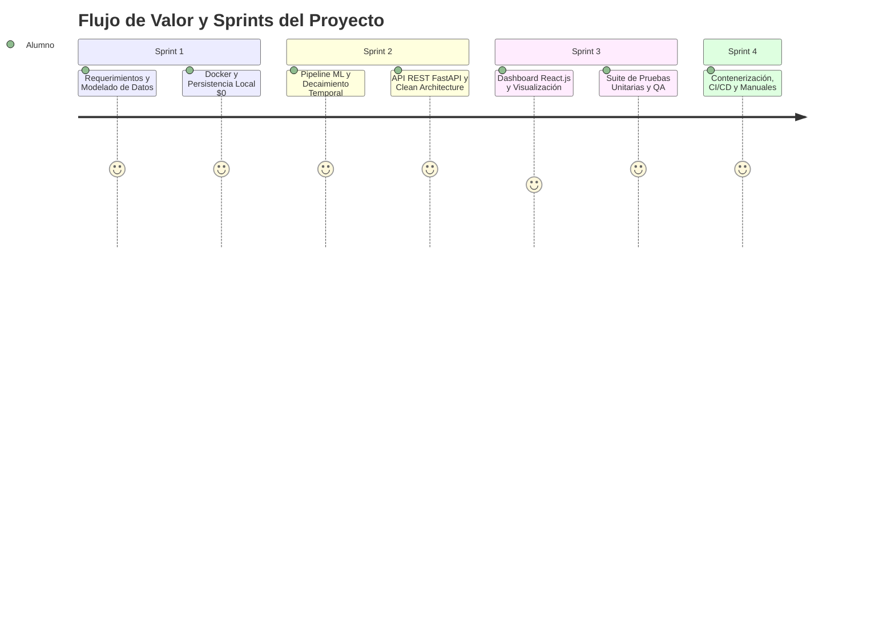

# Reporte Técnico 04: Planificación Operativa y Gestión Ágil (Scrum) del Proyecto

**Proyecto:** Sistema Inteligente de Lead Scoring basado en Inteligencia Artificial y Machine Learning  
**Empresa:** PluriOne S.A. de C.V. (Develop Talent & Technology)  
**Autor:** Alumno de Estadía Profesional - Ingeniería en Sistemas Computacionales  
**Fecha:** Septiembre 2026  
**Fase de Estadía:** 4. Planificación Operativa, Backlog y Gestión Scrum  

---

## 1. Objetivo de la Fase
El objetivo fundamental de esta fase fue estructurar el plan de trabajo operativo, definir el marco metodológico ágil bajo **Scrum**, confeccionar el *Product Backlog* priorizado con base en el valor de negocio para PluriOne S.A. de C.V., desglosar las historias de usuario con criterios de aceptación formalizados y establecer la matriz de gestión de riesgos técnicos y de gobernanza para garantizar el cumplimiento de los tiempos de estadía profesional a costo cero ($0 USD).

---

## 2. Qué se Realizó (Planificación, Historias de Usuario y Backlog)

### 2.1. Definición del Marco Ágil y Roles Scrum
Establecí la organización del equipo de trabajo y las ceremonias ágiles:
- **Product Owner (PO):** Dirección Comercial y de Operaciones de PluriOne (validación del modelo de negocio, reglas de ICP y KPIs).
- **Scrum Master & Developer:** Alumno de Estadía Profesional (arquitectura de software, pipelines de ML, API REST, UI y documentación técnica).
- **Stakeholders:** Ejecutivos comerciales y líderes de atracción de talento TI.

---

### 2.2. Product Backlog Priorizado e Historias de Usuario (Épicas)

Estructuré el backlog en 4 Épicas principales estimadas en Puntos de Historia (*Story Points* con escala Fibonacci):

| ID Épica | Historia de Usuario (US) | Criterios de Aceptación (Gherkin / DoR) | Puntos (SP) | Prioridad |
| :--- | :--- | :--- | :---: | :---: |
| **EP-01** | **US-01: Ingesta de Leads Multicanal** | *Dado* un webhook de HubSpot/CRM, *cuando* se reciba el payload JSON, *entonces* el sistema debe crear o actualizar el prospecto y devolver HTTP 200 en $< 200\,\text{ms}$. | 8 | Alta |
| **EP-01** | **US-02: Pipeline de Scoring Híbrido** | *Dado* un lead con datos demográficos y actividades, *cuando* se solicite scoring, *entonces* se calcula $0.60 \times \text{ML} + 0.40 \times \text{Heurístico} \times \gamma(\Delta t)$. | 13 | Crítica |
| **EP-02** | **US-03: Decaimiento Temporal Dinámico** | *Dado* un prospecto con $\Delta t$ días de inactividad, *cuando* se recalcule su score, *entonces* se aplica $\gamma(\Delta t) = (0.5)^{\frac{\Delta t}{14}}$. | 5 | Alta |
| **EP-02** | **US-04: Explicabilidad con IA (XAI)** | *Dado* un lead calificado, *cuando* el asesor consulte el detalle, *entonces* se muestra un resumen ejecutivo, fortalezas y sugerencia táctica. | 8 | Media |
| **EP-03** | **US-05: Dashboard Analítico React.js** | *Dado* un ejecutivo comercial autenticado, *cuando* ingresa a la aplicación, *entonces* visualiza métricas de conversión, pipeline y prospectos HOT. | 13 | Alta |
| **EP-03** | **US-06: Asignación Comercial Automática** | *Dado* un lead que alcanza categoría `HOT`, *cuando* no tenga asesor, *entonces* se asigna al ejecutivo activo con mayor capacidad. | 5 | Media |
| **EP-04** | **US-07: CI/CD y Despliegue Docker** | *Dado* un commit en la rama `main`, *cuando* se ejecute GitHub Actions, *entonces* deben pasar las pruebas de Pytest y validarse la compilación. | 8 | Alta |

---

### 2.3. Matriz de Gestión de Riesgos Técnicos

| Riesgo Identificado | Probabilidad | Impacto | Estrategia de Mitigación Implementada |
| :--- | :---: | :---: | :--- |
| **Costos imprevistos en la Nube** | Alta | Crítico | Implementación estricta del patrón Puertos y Adaptadores con mocks locales ($0 USD) y base de datos local (SQLite / Docker PostgreSQL). |
| **Desalineación del Algoritmo con Ventas** | Media | Alto | Modelo híbrido (ML + Heurística ICP) que incorpora la experiencia de los asesores seniors de PluriOne desde el primer día. |
| **Obsolescencia de Scores por Inactividad** | Alta | Medio | Modelado matemático de atenuación exponencial continuo con vida media de 14 días. |
| **Falta de Integridad en Esquemas Externos** | Media | Medio | Contenedor de metadatos `raw_metadata` en JSON y validación estricta con Pydantic v2. |

---

## 3. Justificación Técnica
Justifiqué la selección de **Scrum adaptado con sprints quincenales (2 semanas)** frente a una metodología en cascada (*Waterfall*):
1. **Validación Temprana del Modelo de Scoring:** La calificación de prospectos requiere retroalimentación continua del equipo de ventas. Un ciclo iterativo permitió ajustar las ponderaciones heurísticas (ej. peso del cargo directivo frente al canal de adquisición) antes de finalizar el backend.
2. **Desarrollo Guiado por Pruebas e Incrementos Funcionales:** Cada sprint concluye con un entregable de software operable, validado con pruebas automatizadas en Pytest.

---

## 4. Metodología y Arquitectura Aplicada
Implementé la metodología de estimación de esfuerzo mediante **Planning Poker** y la definición rigurosa de los acuerdos de trabajo:
- **Definition of Ready (DoR):** Una historia de usuario solo ingresa a desarrollo si cuenta con esquemas de entrada/salida claramente delimitados, reglas de negocio descritas y criterios de aceptación verificables.
- **Definition of Done (DoD):** Una historia solo se da por finalizada si el código cumple con Clean Architecture, tiene cobertura de pruebas unitarias $\ge 80\%$, pasa el linter de tipado y se documenta en el reporte técnico correspondiente.

---

## 5. Retos Técnicos Superados y Evidencia Funcional

### Reto 1: Estimación Precisa en Entornos de IA y Machine Learning
**Problema:** Las tareas de Machine Learning suelen presentar incertidumbre en tiempos de convergencia y ajuste de hiperparámetros.  
**Solución:** Desacoplé el desarrollo del *pipeline* de datos y el entrenamiento base del modelo del desarrollo de los endpoints de la API, utilizando adaptadores locales para que el backend avanzara sin bloqueos.

### Evidencia Funcional de Planificación
La planificación operativa se tradujo en un plan de trabajo ejecutable de 4 bloques, cuyo progreso se evidencia en la construcción ordenada del repositorio y la finalización puntual de los sprints correspondientes al núcleo de datos y backend.
