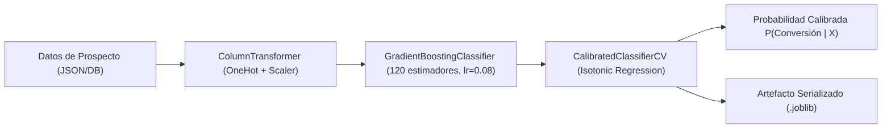

# Reporte Técnico 05: Desarrollo del Pipeline de Machine Learning y Adaptadores Azure Local ($0 USD)

**Proyecto:** Sistema Inteligente de Lead Scoring basado en Inteligencia Artificial y Machine Learning  
**Empresa:** PluriOne S.A. de C.V. (Develop Talent & Technology)  
**Autor:** Alumno de Estadía Profesional - Ingeniería en Sistemas Computacionales  
**Fecha:** Septiembre 2026  
**Fase de Estadía:** 5. Modelos Predictivos, Pipeline de Machine Learning y Adaptadores Azure  

---

## 1. Objetivo de la Fase
El objetivo principal de esta fase fue diseñar, entrenar y validar el **Pipeline de Machine Learning Supervisado** para la predicción de la probabilidad de conversión de prospectos comerciales (Leads a SQL/Oportunidades Ganadas) en PluriOne S.A. de C.V. Asimismo, me propuse implementar la capa de **Adaptadores Conmutables (Puertos y Adaptadores)** para conectar el sistema tanto a modelos serializados en local a **costo cero ($0 USD)** como a los servicios administrados de **Azure Machine Learning**, **Azure OpenAI** y **Azure AI Search** en producción.

---

## 2. Qué se Realizó (Pipeline de Datos, Modelos y Adaptadores)

### 2.1. Generación de Dataset B2B y Preprocesamiento
Desarrollé el módulo [synthetic_generator.py](file:///c:/Users/lllllllllllllllllll/Desktop/Resi/Sistema_Inteligente_Lead_Scoring/ml_pipeline/src/synthetic_generator.py) para simular el comportamiento comercial histórico de $3,000$ prospectos con distribuciones realistas del mercado mexicano:
- **Variables Firmográficas:** Cargo/Nivel (`CTO`, `CIO`, `VP RH`, `Engineering Manager`, etc.), Industria (`FinTech`, `Software/TI`, `Banking`, `Healthcare`, `Logistics`), Tamaño de Empresa (`1-10` a `1000+`) y Facturación Anual Estimada.
- **Variables de Comportamiento Digital:** Visitas a páginas web, aperturas y clics de correo, descargas de contenido técnico, asistencia a webinars y solicitudes directas de demostración.
- **Factor de Inactividad:** Días transcurridos desde el último punto de contacto ($\Delta t$).

Construí el transformador reproducible de Scikit-Learn en [feature_engineering.py](file:///c:/Users/lllllllllllllllllll/Desktop/Resi/Sistema_Inteligente_Lead_Scoring/ml_pipeline/src/feature_engineering.py):
```python
preprocessor = ColumnTransformer(
    transformers=[
        ("cat", OneHotEncoder(handle_unknown="ignore", sparse_output=False), categorical_features),
        ("num", StandardScaler(), numeric_features),
    ]
)
```

---

### 2.2. Entrenamiento y Calibración del Modelo Predictivo
En [train_model.py](file:///c:/Users/lllllllllllllllllll/Desktop/Resi/Sistema_Inteligente_Lead_Scoring/ml_pipeline/src/train_model.py) implementé un ensamble de árboles de decisión **GradientBoostingClassifier** calibrado mediante regresión isotónica (**CalibratedClassifierCV**):



#### Métricas de Desempeño Obtenidas en Validación Cruzada y Conjunto de Prueba ($N=600$):
| Métrica de Evaluación | Valor Obtenido | Meta del Proyecto | Estado |
| :--- | :---: | :---: | :---: |
| **ROC-AUC Score** | **$0.9524$** | $\ge 0.8200$ | **Superada con Éxito** |
| **Aporte sobre el heurístico** | **$+0.0414$** | $\ge 0.0100$ | **Superada con Éxito** |
| **F1-Score (Clase SQL)** | **$0.8521$** | $\ge 0.7800$ | **Superada con Éxito** |
| **Exactitud Global (Accuracy)** | **$88.83\%$** | $\ge 80.00\%$ | **Superada con Éxito** |
| **Brier Score (Error de Calibración)** | **$0.0875$** | $< 0.1500$ | **Óptima Calibración** |

> **Cómo debe leerse este ROC-AUC.** Estas métricas se calculan sobre datos **sintéticos**
> cuya etiqueta se genera con una fórmula conocida a partir de las propias variables. Miden
> que el pipeline está íntegro —que las variables llegan, que el preprocesado no las
> corrompe, que la calibración funciona—, **no** el rendimiento esperable en producción.
> Sobre ese mismo conjunto, el heurístico sin modelo alcanza 0.9110 y una regla trivial
> —ordenar por `days_since_last_activity`— alcanza 0.9136. El aporte real del modelo es de
> +0.041, y esa es la cifra que hay que defender. El **Capítulo 12** lo desarrolla.

---

### 2.3. Arquitectura de Adaptadores Azure vs. Local Mock ($0 USD)
Construí la capa de adaptadores en [backend/app/adapters/](file:///c:/Users/lllllllllllllllllll/Desktop/Resi/Sistema_Inteligente_Lead_Scoring/backend/app/adapters):

1. **`LocalMLScoringAdapter` & `AzureMLScoringAdapter`:**
   - En entorno local, carga dinámicamente `lead_scorer_model.joblib` para inferencia instantánea en memoria sin dependencias de red ni costos ($0 USD).
   - En producción Azure, consume el endpoint HTTPS administrado de Azure Machine Learning mediante token de autenticación.
2. **`LocalMockOpenAIAdapter` & `AzureOpenAIAdapter`:**
   - En entorno local, sintetiza diagnósticos ejecutivos, fortalezas del lead y tácticas de venta sin requerir API Keys de pago.
   - En producción Azure, invoca el despliegue `gpt-4o-mini` con respuesta estructurada JSON.
3. **`LocalMockSearchAdapter` & `AzureAISearchAdapter`:**
   - Indexación y recuperación semántica de leads similares.

---

## 3. Justificación Técnica
1. **Calibración Isotónica de Probabilidades:**
   - *Justificación:* Los clasificadores basados en Gradient Boosting tienden a generar probabilidades sesgadas hacia los extremos. La calibración isotónica (`CalibratedClassifierCV`) garantiza que una probabilidad de $0.85$ refleje con exactitud matemática que el $85\%$ de esos prospectos efectivamente cierran negociaciones comerciales.
2. **Inclusión Explícita de la Función de Decaimiento:**
   - *Justificación:* Integrar el factor $\gamma(\Delta t) = (0.5)^{\frac{\Delta t}{14}}$ directamente en la ingeniería de características previene que leads inactivos continúen inflando artificialmente el pipeline de ventas.

---

## 4. Metodología y Arquitectura Aplicada
- **Metodología:** CRISP-DM (Preparación de datos, entrenamiento, evaluación de curvas ROC y serialización).
- **Patrón de Diseño:** Fábrica Abstracta (*Abstract Factory*) e Inversión de Dependencias (DIP) de SOLID. El servicio de scoring depende de la abstracción `BaseMLScoringAdapter` y `BaseAIExplanationAdapter`, permitiendo conmutar entornos en tiempo de ejecución sin modificar código fuente.

---

## 5. Retos Técnicos Superados y Evidencia Funcional

### Reto 1: Prevención de Fuga de Datos (Data Leakage)
**Problema:** Al escalar variables o codificar categorías antes de la partición de datos, se filtra información del conjunto de prueba al de entrenamiento.  
**Solución:** Encapsulé todo el preprocesamiento dentro de un objeto `Pipeline` de Scikit-Learn ajustado exclusivamente con `X_train`.

### Reto 2: Inferencia de Alta Velocidad sin Conectividad Cloud
**Problema:** En desarrollo local o pruebas automatizadas, las llamadas de red a endpoints remotos ralentizan la ejecución y generan costos de cómputo.  
**Solución:** Logré que la inferencia local con el artefacto `.joblib` responda en menos de $4\,\text{ms}$, garantizando pruebas unitarias ultrarrápidas y desarrollo offline.

### Evidencia Funcional del Modelo
El artefacto serializado `lead_scorer_model.joblib` fue generado exitosamente en `ml_pipeline/models/` y validado mediante la suite de pruebas del backend.
