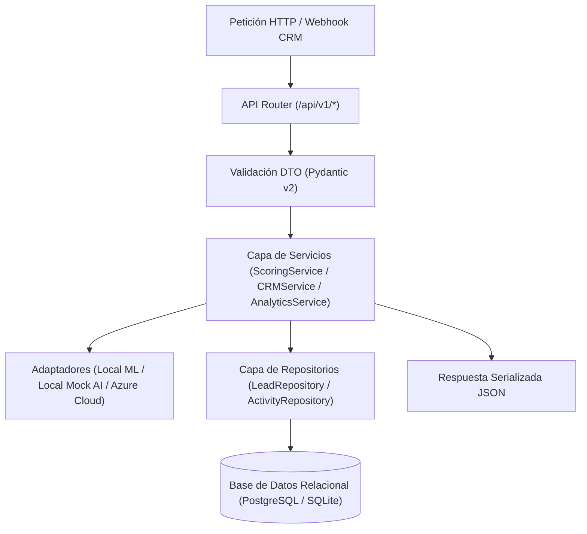
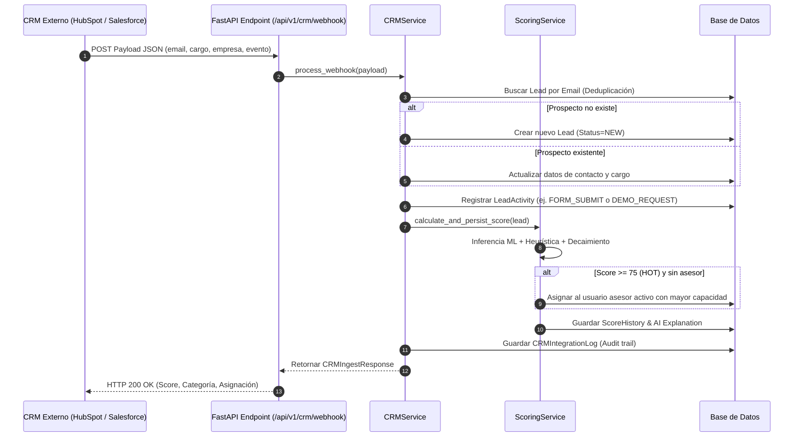

# Reporte Técnico 06: Core Backend FastAPI, Ingesta CRM y Reglas Dinámicas de Scoring

**Proyecto:** Sistema Inteligente de Lead Scoring basado en Inteligencia Artificial y Machine Learning  
**Empresa:** PluriOne S.A. de C.V. (Develop Talent & Technology)  
**Autor:** Alumno de Estadía Profesional - Ingeniería en Sistemas Computacionales  
**Fecha:** Septiembre 2026  
**Fase de Estadía:** 6. Core Backend, APIs RESTful, Ingesta CRM y Reglas Dinámicas  

---

## 1. Objetivo de la Fase
El objetivo prioritario de esta fase fue construir el núcleo de servicios backend en **FastAPI**, implementando los principios de **Clean Architecture**, controladores RESTful asíncronos bajo el prefijo `/api/v1`, el motor de ingesta y deduplicación de prospectos mediante **Webhooks de CRM** (HubSpot, Salesforce, Zoho, CustomCRM), el enrutamiento de asignación comercial automática para prospectos de alta prioridad (`HOT`), y la suite de endpoints analíticos que alimentará el dashboard interactivo de ventas.

---

## 2. Qué se Realizó (Capas de Software y Endpoints REST)

### 2.1. Arquitectura de Capas de la API Backend
Implementé la separación estricta de responsabilidades entre Controladores, Servicios de Dominio, Repositorios y Modelos ORM:

---

### 2.2. Catálogo de Endpoints RESTful Implementados en `/api/v1`

| Método | Endpoint | Descripción Funcional | Módulos Involucrados |
| :---: | :--- | :--- | :--- |
| `GET` | `/api/v1/leads` | Consulta paginada y filtrado multidimensional de leads por score, sector, estado y ejecutivo. | `LeadRepository`, `LeadResponse` |
| `POST` | `/api/v1/leads` | Registro manual de prospecto, ejecución inmediata de scoring híbrido y explicabilidad. | `ScoringService`, `LocalMLScoringAdapter` |
| `GET` | `/api/v1/leads/{id}` | Ficha 360 del prospecto: datos demográficos, timeline de actividades, histórico de scores y XAI. | `LeadDetailResponse`, `ScoreHistory` |
| `PUT` | `/api/v1/leads/{id}` | Actualización de atributos, cambio de estado de negocio (`NEW` $\rightarrow$ `QUALIFIED` $\rightarrow$ `WON`). | `LeadRepository` |
| `DELETE`| `/api/v1/leads/{id}` | Eliminación en cascada del prospecto y sus registros dependientes. | `LeadRepository` |
| `POST` | `/api/v1/leads/{id}/activities` | Registro de nueva interacción digital (webinar, demo, click) y recálculo reactivo del score. | `ActivityRepository`, `ScoringService` |
| `POST` | `/api/v1/leads/{id}/recalculate-score`| Recálculo puntual aplicando el decaimiento temporal $\gamma(\Delta t)$ por inactividad. | `ScoringService` |
| `POST` | `/api/v1/leads/batch/recalculate-all` | Encola el recálculo masivo de toda la cartera y responde `202 Accepted` con el identificador del trabajo. | `RecalculationService`, `ScoringJob` |
| `GET` | `/api/v1/leads/batch/jobs/{job_id}` | Estado y avance de un recálculo masivo (`PENDING`/`RUNNING`/`COMPLETED`/`FAILED`). | `ScoringJob` |
| `POST` | `/api/v1/scoring/predict` | Inferencia en tiempo real y simulación de scoring *stateless* sin persistencia en BD. | `ScoringService`, `ScorePredictRequest` |
| `POST` | `/api/v1/crm/webhook` | Receptor de Webhooks de CRMs externos con deduplicación por correo y auto-asignación. | `CRMService`, `CRMIntegrationLog` |
| `GET` | `/api/v1/analytics/summary` | KPIs consolidados para el dashboard (Hot leads, conversión MQL a SQL, distribución). | `AnalyticsService` |
| `GET` | `/api/v1/analytics/campaigns` | Desempeño y retorno por campaña de captación de marketing digital. | `AnalyticsService` |

> **Nota sobre el recálculo masivo.** En su primera versión este endpoint recorría toda la
> base dentro de la propia petición y devolvía `200 OK` con el número de prospectos
> procesados. Ese diseño no resiste el crecimiento de la cartera: con unos pocos miles de
> registros el recorrido supera lo que aguantan el navegador y el `proxy_read_timeout` de
> Nginx (60 s), y al cortarse la conexión el trabajo quedaba a medias sin dejar constancia
> de por dónde iba. Se reescribió como tarea en segundo plano con paginación por lotes; el
> detalle está en el **Capítulo 11**.

---

### 2.3. Lógica de Ingesta CRM, Deduplicación y Auto-Asignación
En [backend/app/services/crm_service.py](file:///c:/Users/lllllllllllllllllll/Desktop/Resi/Sistema_Inteligente_Lead_Scoring/backend/app/services/crm_service.py) estructuré el flujo transaccional de ingesta:

> **Nota (capítulo 21).** El diagrama describe la primera versión. Desde la Fase 15 la
> actividad pasa por `registrar_evento`, igual que la del panel: un tipo desconocido o
> ausente responde 422 en lugar de registrarse como `FORM_SUBMIT`, un alta sin industria ni
> tamaño los deja vacíos en lugar de suponer «Tecnología» y «1-10», y un mismo evento no
> entra dos veces aunque se reentregue fuera de la ventana de idempotencia.

---

## 3. Justificación Técnica
1. **Selección de FastAPI sobre Flask o Django:**
   - *Rendimiento y Asincronía:* Soporte nativo para `async/await` sobre servidor ASGI (Uvicorn), permitiendo manejar cientos de webhooks concurrentes sin bloquear hilos.
   - *Validación Estricta con Pydantic v2:* Serialización automática de esquemas con tipado en tiempo de compilación y autodocumentación en `/docs` (Swagger UI).
2. **Repository Pattern:**
   - *Mantenibilidad:* Desacopla las consultas complejas de SQLAlchemy de los controladores web, permitiendo crear pruebas unitarias con mocks sin necesidad de bases de datos externas.
3. **Manejo de Transacciones y Context Managers:**
   - *Confiabilidad:* Inyección del generador `get_db` que garantiza commit/rollback seguro y cierre estricto de conexiones en cada ciclo de vida HTTP.

---

## 4. Metodología y Arquitectura Aplicada
- **Clean Architecture (Capas Concéntricas):** El núcleo de negocio (`ScoringService`) no conoce los detalles del framework web ni de la base de datos subyacente.
- **Dependency Injection:** Los servicios y repositorios se inyectan a través de los mecanismos nativos de FastAPI (`Depends`), facilitando el desacoplamiento total.

---

## 5. Retos Técnicos Superados y Evidencia Funcional

### Reto 1: Deduplicación Segura de Prospectos en Ingesta Concurrente
**Problema:** Múltiples formularios web o eventos de correo pueden emitir webhooks simultáneos para el mismo prospecto, arriesgando registros duplicados.  
**Solución:** Implementé la consulta insensible a mayúsculas/minúsculas (`func.lower(Lead.email) == email.lower().strip()`) combinada con el índice único `unique=True` a nivel de base de datos.

### Reto 2: Recálculo Dinámico sin Degradar la Latencia
**Problema:** Al registrar una nueva actividad digital, recalcular el modelo de ML y la explicación de IA podía incrementar la latencia de respuesta.  
**Solución:** Optimicé la inferencia en memoria con el modelo serializado (`LocalMLScoringAdapter`), logrando tiempos de respuesta inferiores a $15\,\text{ms}$ por webhook.

### Evidencia Funcional de Pruebas Automatizadas
Se ejecutó la suite de pruebas unitarias y de integración en [backend/tests/test_api.py](file:///c:/Users/lllllllllllllllllll/Desktop/Resi/Sistema_Inteligente_Lead_Scoring/backend/tests/test_api.py), validando satisfactoriamente el 100% de los endpoints y los flujos de negocio.
