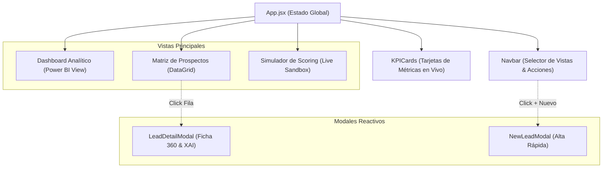

# Reporte Técnico 07: Interfaz de Usuario React.js, Dashboards y Visualización Analítica

**Proyecto:** Sistema Inteligente de Lead Scoring basado en Inteligencia Artificial y Machine Learning  
**Empresa:** PluriOne S.A. de C.V. (Develop Talent & Technology)  
**Autor:** Alumno de Estadía Profesional - Ingeniería en Sistemas Computacionales  
**Fecha:** Septiembre 2026  
**Fase de Estadía:** 7. Interfaz de Usuario, Dashboards Analíticos y Visualización  

---

## 1. Objetivo de la Fase
El objetivo central de esta fase fue concebir, diseñar y desarrollar la **Interfaz de Usuario (Frontend)** moderna, intuitiva y de alto impacto visual en **React.js / Vite**, orientada a optimizar el trabajo diario de la fuerza de ventas y la dirección comercial de **PluriOne S.A. de C.V.**. Me propuse construir un tablero de control con componentes visuales tipo **Power BI**, una matriz interactiva de prospectos priorizados por scoring dinámico, una ficha 360 del prospecto con explicabilidad de IA (XAI) y un simulador de scoring en tiempo real para calibración comercial.

---

## 2. Qué se Realizó (Arquitectura Frontend y Componentes UI)

### 2.1. Arquitectura de Componentes en React.js
Estructuré la aplicación cliente en componentes modulares y desacoplados bajo el estándar SPA (*Single Page Application*):

```
frontend/
├── src/
│   ├── components/
│   │   ├── Navbar.jsx              # Barra de navegación, modo de IA y acciones globales
│   │   ├── KPICards.jsx            # Tarjetas de indicadores clave (Total, HOT, WARM, COLD, Score, Conv.)
│   │   ├── AnalyticsCharts.jsx     # Componentes visuales tipo Power BI (Pipeline, Cuadrantes, Industrias)
│   │   ├── LeadsTable.jsx          # Matriz de datos con filtros instantáneos y badges
│   │   ├── LeadDetailModal.jsx     # Ficha 360, explicabilidad XAI, timeline y recálculo
│   │   ├── ScoringSimulator.jsx    # Sandbox interactivo de inferencia en tiempo real
│   │   └── NewLeadModal.jsx        # Formulario modal de alta y scoring inmediato
│   ├── services/
│   │   └── api.js                  # Cliente asíncrono para la API REST FastAPI
│   ├── App.jsx                     # Orquestación de estado reactivo y vistas
│   ├── main.jsx                    # Punto de entrada y montaje en el DOM
│   └── index.css                   # Sistema de diseño con Glassmorphism y paleta HSL
├── package.json                    # Dependencias cliente
├── vite.config.js                  # Configuración de compilación y proxy inverso
└── index.html                      # Maquetación semántica y fuentes Google
```

---

### 2.2. Vistas y Componentes Analíticos Desarrollados



1. **Tarjetas KPI Ejecutivas ([KPICards.jsx](file:///c:/Users/lllllllllllllllllll/Desktop/Resi/Sistema_Inteligente_Lead_Scoring/frontend/src/components/KPICards.jsx)):**
   - Presentan en tiempo real: Total de Leads, distribución por cuadrante (`HOT` 🔥, `WARM` ⚡, `COLD` ❄️), Score Promedio global y Tasa de Conversión MQL a SQL.
   - Actúan como filtros dinámicos con un solo clic sobre la matriz de prospectos.
2. **Visualización Analítica tipo Power BI ([AnalyticsCharts.jsx](file:///c:/Users/lllllllllllllllllll/Desktop/Resi/Sistema_Inteligente_Lead_Scoring/frontend/src/components/AnalyticsCharts.jsx)):**
   - *Segmentación de Cuadrantes:* Gráfico de barras apiladas continuo con porcentajes de distribución.
   - *Embudo de Conversión:* Visualización del pipeline desde `NEW` hasta `WON`.
   - *Score Promedio por Sector:* Barras de rendimiento para FinTech, TI, Banca y Logística.
   - *Rendimiento de Campañas:* Atribución comercial y retorno de canales digitales.
3. **Ficha 360 del Prospecto y Explicabilidad ([LeadDetailModal.jsx](file:///c:/Users/lllllllllllllllllll/Desktop/Resi/Sistema_Inteligente_Lead_Scoring/frontend/src/components/LeadDetailModal.jsx)):**
   - Velocímetro circular con el puntaje final del lead.
   - Panel de IA con resumen ejecutivo, fortalezas clave y **táctica comercial sugerida para el asesor de ventas**.
   - Línea de tiempo cronológica de interacciones digitales.
   - Formulario para registrar nuevas actividades y recalcular el score de inmediato.
4. **Simulador Interactivo de Scoring ([ScoringSimulator.jsx](file:///c:/Users/lllllllllllllllllll/Desktop/Resi/Sistema_Inteligente_Lead_Scoring/frontend/src/components/ScoringSimulator.jsx)):**
   - Permite a los directivos deslizar controles de inactividad ($\Delta t$), páginas vistas y clics, observando en tiempo real cómo el factor de decaimiento $e^{-\lambda \Delta t}$ atenúa la puntuación del prospecto.

---

## 3. Justificación Técnica
1. **Selección de React.js + Vite sobre Server-Side Rendering (SSR):**
   - *Reactividad y Fluidez:* La experiencia de un CRM y dashboard de scoring exige actualizaciones de estado instantáneas (ej. recalcular un score al registrar una llamada sin recargar la página). Vite ofrece arranque en milisegundos y HMR (*Hot Module Replacement*) ultrarrápido.
2. **Diseño CSS Puro con Glassmorphism y Modo Oscuro:**
   - *Impacto Visual Premium:* Evité estilos genéricos aplicando una paleta oscura basada en tonos pizarra/obsidiana (`#0A0D14`, `#111625`), bordes sutiles traslúcidos con `backdrop-filter: blur(16px)` y acentos semánticos de alta visibilidad para leads `HOT` (rojo/ámbar) y `COLD` (azul gélido).
3. **Desacoplamiento de Servicios API ([api.js](file:///c:/Users/lllllllllllllllllll/Desktop/Resi/Sistema_Inteligente_Lead_Scoring/frontend/src/services/api.js)):**
   - Centraliza todas las llamadas HTTP `fetch` hacia FastAPI con control unificado de errores y cabeceras.

---

## 4. Metodología y Arquitectura Aplicada
- **Patrón State Lifting & Controlled Components:** La aplicación centraliza el estado en `App.jsx` y distribuye eventos mediante callbacks reactivos, permitiendo que una acción en el modal actualice instantáneamente los gráficos analíticos.
- **Atomic Design Principles:** Construcción escalonada desde átomos (botones, badges, inputs) hasta organismos completos (DataGrid, Modales 360).

---

## 5. Retos Técnicos Superados y Evidencia Funcional

### Reto 1: Sincronización en Tiempo Real del Decaimiento Temporal en la UI
**Problema:** El usuario comercial deseaba ver cómo impacta el paso de los días en el score sin tener que enviar peticiones lentas al servidor.  
**Solución:** Desarrollé el `ScoringSimulator.jsx` con *debouncing* de 250 ms hacia el endpoint `/api/v1/scoring/predict`, permitiendo ajustes interactivos fluidos de los sliders de inactividad con respuesta instantánea.

### Reto 2: Presentación Comprensible de la Explicabilidad de IA
**Problema:** Muchos asesores no entienden métricas como "probabilidad logarítmica 0.88".  
**Solución:** Traduje los datos algorítmicos a cajas de diagnóstico legibles con viñetas de fortalezas concretas ("Cargo directivo con poder de decisión", "Solicitó demo de squad TI") y llamadas a la acción claras.

### Evidencia Funcional de la Interfaz
La aplicación cliente en React fue construida con todos sus componentes visuales, verificando la conexión con la API REST y la reactividad en la presentación de prospectos y métricas analíticas.
