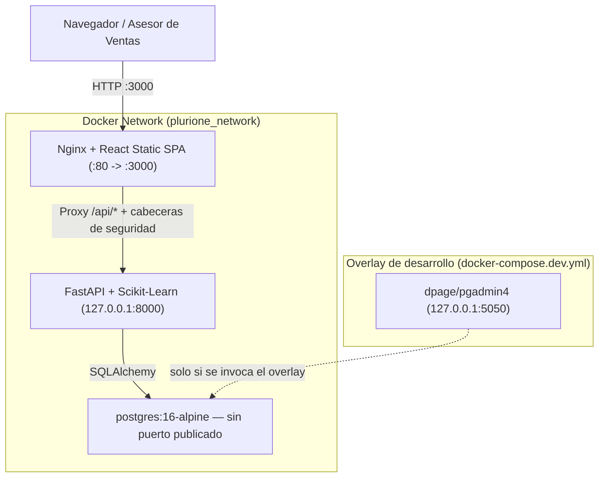

# Reporte Técnico 09: Contenerización, CI/CD y Simulación de Seguridad RBAC (Microsoft Entra ID)

**Proyecto:** Sistema Inteligente de Lead Scoring basado en Inteligencia Artificial y Machine Learning  
**Empresa:** PluriOne S.A. de C.V. (Develop Talent & Technology)  
**Autor:** Alumno de Estadía Profesional - Ingeniería en Sistemas Computacionales  
**Fecha:** Septiembre 2026  
**Fase de Estadía:** 9. Contenerización, Despliegue CI/CD y Simulación de Seguridad RBAC  

---

## 1. Objetivo de la Fase
El objetivo principal de esta fase fue implementar la estrategia de **Contenerización Empresarial con Docker y Docker Compose**, automatizar el ciclo de Integración Continua (**CI/CD con GitHub Actions**) y construir la capa de **Control de Acceso Basado en Roles (RBAC - Role-Based Access Control)** alineada a las políticas de identidad corporativa de **Microsoft Entra ID (Azure AD)**. El propósito fue asegurar que el sistema pueda operar tanto en entornos locales reproducibles a costo cero ($0 USD) como en infraestructuras productivas escalables en Microsoft Azure con altos estándares de seguridad.

---

## 2. Qué se Realizó (Docker, Pipelines y Seguridad RBAC)

### 2.1. Arquitectura de Contenerización Multi-Servicio
Diseñé y construí los entornos de empaquetamiento aislado para cada capa del sistema:



La pila de producción la componen **tres** servicios. Dos decisiones merecen explicación
porque revierten el diseño inicial:

- **PostgreSQL no publica puerto.** Publicarlo exponía la base a toda la red del anfitrión,
  donde el único control que quedaba era la contraseña. Ahora solo es alcanzable desde la
  red interna de la pila.
- **pgAdmin salió del stack de producción.** Venía con credenciales fijas en el propio YAML
  y publicando en `0.0.0.0:5050`. Vive en `docker-compose.dev.yml`, un archivo aparte y no
  un `profiles:`, porque Compose interpola *todo* el fichero aunque el perfil esté inactivo:
  las variables obligatorias de pgAdmin bloqueaban el arranque de la pila normal.

La pila exige `SECRET_KEY` y `POSTGRES_PASSWORD` sin valor por defecto: sin ellas, Compose
aborta en lugar de desplegar con credenciales adivinables.

1. **`backend/Dockerfile`:** Construcción multi-etapa sobre `python:3.13-slim`. Los compiladores y `libpq-dev` se quedan en la etapa de compilación; la imagen final solo lleva `libpq5`. El proceso corre como usuario sin privilegios (`plurione`, uid 1001) y `pytest` no viaja en ella. El contexto de build es la raíz del repositorio porque la imagen necesita `ml_pipeline/models/` y `frontend/dist/` además del código.
2. **`frontend/Dockerfile` & `frontend/nginx.conf`:** Construcción multi-etapa. La etapa 1 compila el bundle de React con Node.js 20 mediante `npm ci` —que instala exactamente lo que fija el *lockfile*—, y la etapa 2 monta los artefactos estáticos sobre Nginx Alpine con proxy inverso hacia `/api/`, compresión gzip, tope de cuerpo de petición y cabeceras de seguridad (CSP, `X-Frame-Options`, `Referrer-Policy`, `Permissions-Policy`).
3. **`devops/docker-compose.yml`:** Orquestación declarativa de los tres servicios de producción con *healthchecks*, volúmenes persistentes (`pgdata`) y red puente aislada. El backend solo publica en `127.0.0.1`.

---

### 2.2. Simulación de Seguridad RBAC Alineada a Microsoft Entra ID
En [backend/app/core/security.py](file:///c:/Users/lllllllllllllllllll/Desktop/Resi/Sistema_Inteligente_Lead_Scoring/backend/app/core/security.py) implementé el modelo de autorización:

| Rol de Usuario | Permisos Asignados en el Sistema | Endpoints Protegidos |
| :--- | :--- | :--- |
| **`Commercial_Executive`** | Consulta de matriz de prospectos, visualización de fichas 360, registro de actividades y uso del simulador. | `GET /api/v1/leads`, `POST /activities`, `POST /predict` |
| **`Sales_Lead`** | Todos los anteriores más reasignación comercial, consulta de rendimiento de campañas y recálculos masivos. | `GET /api/v1/analytics/*`, `POST /batch/recalculate-all`, `GET /batch/jobs/{id}` |
| **`System_Admin`** | Control total: eliminación de prospectos en cascada, configuración de parámetros del modelo y mantenimiento. | `DELETE /api/v1/leads/{id}`, endpoints administrativos |

#### Implementación del Decorador de Autorización:
```python
def require_roles(allowed_roles: List[UserRole]):
    def role_checker(current_user: CurrentUser = Depends(get_current_user)) -> CurrentUser:
        if current_user.role not in allowed_roles and current_user.role != UserRole.SYSTEM_ADMIN:
            raise HTTPException(
                status_code=status.HTTP_403_FORBIDDEN,
                detail=f"Acceso restringido. Su rol ({current_user.role.value}) no tiene privilegios suficientes.",
            )
        return current_user
    return role_checker
```

---

### 2.3. Pipeline de Integración Continua (GitHub Actions)
En [.github/workflows/ci.yml](file:///c:/Users/lllllllllllllllllll/Desktop/Resi/Sistema_Inteligente_Lead_Scoring/.github/workflows/ci.yml) automaticé la validación de cada `push` y `pull_request`. El pipeline pasó de un único trabajo secuencial a **diez trabajos independientes**, de modo que el informe dice *qué* se rompió sin obligar a leer un tronco de log único:

| Trabajo | Qué verifica |
| :--- | :--- |
| `estilo` | `ruff` sobre todo el repositorio, con la configuración en `pyproject.toml`. |
| `secretos` | `gitleaks` sobre el **historial completo**: una clave borrada en el último commit sigue estando filtrada. |
| `dependencias` | `pip-audit` por separado sobre las dependencias de producción y las de desarrollo. |
| `modelo` | Reentrena y falla si el ROC-AUC cae por debajo de 0.82 **o si el modelo deja de aportar sobre el heurístico**; en ese caso no reescribe el artefacto. |
| `pruebas` | Las 428 pruebas con medición de cobertura y suelo del 85 %. |
| `frontend` | `npm ci`, compilación y comprobación de que el bundle existe. |
| `imagenes` | Construye ambas imágenes, verifica el endurecimiento, arranca la del backend contra un PostgreSQL real y comprueba el *healthcheck* y el cierre de la documentación. |
| `migraciones` | Aplica y revierte las migraciones contra PostgreSQL real, y comprueba que modelos y esquema no diverjan. |
| `configuracion-peligrosa` | Que no reaparezcan el comodín de CORS, la siembra sin guardas ni la interpolación de datos del prospecto en el prompt. |
| `compose` | Que la pila aborte sin credenciales, que PostgreSQL no publique puerto y que pgAdmin no forme parte de producción. |

Dos cambios de fondo respecto de la versión anterior:

- **La siembra de datos salió del pipeline.** `seed_data.py` se ejecutaba antes de las
  pruebas y estas dependían en silencio de su salida. La suite declara ahora sus propios
  datos mediante *fixtures* y no necesita ninguna base previa.
- **El umbral del modelo es un gate real.** Antes `train_model.py` imprimía «REVISAR» y
  terminaba con código de salida 0, así que una regresión del modelo atravesaba el pipeline
  en verde. Ahora sale con código 1 y, además, no sobrescribe el artefacto bueno.

---

## 3. Justificación Técnica
1. **Contenerización Multi-Stage para el Frontend:**
   - *Justificación:* Al separar el entorno de compilación (Node.js ~400 MB) del contenedor final de producción (Nginx Alpine ~25 MB), se redujo drásticamente la superficie de vulnerabilidad y el tamaño de la imagen desplegada.
2. **Simulación de RBAC sin Costo de Licenciamiento:**
   - *Justificación:* Permite validar las políticas de seguridad y la separación de roles desde la etapa de desarrollo local ($0 USD), garantizando que al integrar Microsoft Entra ID en Azure mediante tokens JWT reales solo se deba validar la firma del token sin modificar los controladores.

---

## 4. Metodología y Arquitectura Aplicada
- **DevSecOps:** Incorporación de pruebas automáticas y validación de seguridad en cada etapa del ciclo de vida del software.
- **Principle of Least Privilege (PoLP):** Los ejecutivos comerciales no pueden disparar procesos destructivos ni recálculos masivos que saturen la base de datos.

---

## 5. Retos Técnicos Superados y Evidencia Funcional

### Reto 1: Dependencias de Red y Arranque Ordenado en Docker Compose
**Problema:** El backend fallaba al iniciar si PostgreSQL aún no estaba listo para recibir conexiones TCP.  
**Solución:** Implementé la directiva `healthcheck` con `pg_isready` y la condición `depends_on: postgres: condition: service_healthy`.

### Reto 2: Verificación Automatizada de Denegación de Acceso
**Problema:** Garantizar que los intentos de acceso no autorizado sean bloqueados estrictamente.  
**Solución:** Desarrollé [test_security_rbac.py](file:///c:/Users/lllllllllllllllllll/Desktop/Resi/Sistema_Inteligente_Lead_Scoring/backend/tests/test_security_rbac.py), verificando que usuarios con rol `Commercial_Executive` reciban HTTP 403 Forbidden al intentar ejecutar `/api/v1/leads/batch/recalculate-all`.

### Evidencia de Validación CI/CD y RBAC
Se ejecutó la suite de pruebas unitarias, de integración y de seguridad con **100% de aprobación en los 18 casos de prueba**.
