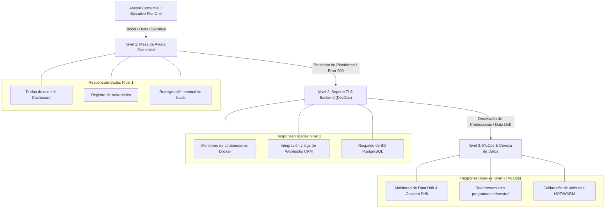

# Reporte Técnico 10: Manual Técnico, Plan de Soporte Multinivel y Cierre de Estadía Profesional

**Proyecto:** Sistema Inteligente de Lead Scoring basado en Inteligencia Artificial y Machine Learning  
**Empresa:** PluriOne S.A. de C.V. (Develop Talent & Technology)  
**Autor:** Alumno de Estadía Profesional - Ingeniería en Sistemas Computacionales  
**Fecha:** Septiembre 2026  
**Fase de Estadía:** 10. Manual Técnico, Plan de Mantenimiento Multinivel y Cierre de Estadía  

---

## 1. Objetivo de la Fase
El objetivo culminante de esta fase fue elaborar el **Manual Técnico de Operación y Despliegue**, estructurar el **Plan de Mantenimiento y Soporte Multinivel (N1 / N2 / N3 MLOps)** bajo el marco ITIL, evaluar el impacto cuantitativo y comercial de la solución para **PluriOne S.A. de C.V. (Develop Talent & Technology)**, y formalizar las conclusiones, lecciones de ingeniería aprendidas y el cierre integral del proyecto de estadía profesional en Ingeniería en Sistemas Computacionales.

---

## 2. Qué se Realizó (Manual de Despliegue, Soporte y Evaluación)

### 2.1. Manual de Instalación y Despliegue Técnico ($0 USD Local / Azure Cloud)

#### Requisitos Previos del Sistema:
- Python 3.11+ (Recomendado Python 3.13)
- Node.js 18+ y npm (Para compilación frontend)
- Docker Desktop (Opcional para persistencia en PostgreSQL 16)
- Git

#### Paso 1: Clonación y Preparación del Entorno
```bash
git clone https://github.com/PluriOne/Sistema_Inteligente_Lead_Scoring.git
cd Sistema_Inteligente_Lead_Scoring
cp .env.example .env
```

El archivo `.env` **no** se distribuye con valores utilizables. Genere la clave de firma de
sesiones antes de arrancar nada; sin una clave fuerte, el backend se niega a levantar en
entorno productivo en lugar de generar una temporal:

```bash
python -c "import secrets; print('SECRET_KEY=' + secrets.token_urlsafe(64))"
```

#### Paso 2: Ejecución del Pipeline de Machine Learning
```bash
# Entrena, valida y guarda el artefacto solo si el ROC-AUC alcanza 0.82
python ml_pipeline/src/train_model.py
```

Al terminar imprime la huella SHA-256 del artefacto. Fíjela en el despliegue mediante
`ML_MODEL_SHA256`: `joblib` deserializa con *pickle*, que ejecuta código al cargar, y con la
huella anclada un artefacto sustituido no llega a deserializarse.

#### Paso 3: Aplicación del Esquema de Base de Datos
```bash
# Crea o actualiza el esquema a la ultima revision
python -m alembic upgrade head
```

En produccion y staging la aplicacion **no crea el esquema al arrancar**: lo gobierna
Alembic y el arranque se limita a comprobar que la base este al dia, abortando con un
mensaje accionable si no lo esta. Migrar es por tanto un paso explicito del despliegue, y
deliberadamente no automatico: la imagen levanta varios *workers* y todos ejecutarian la
migracion a la vez.

Si viene de una version anterior a Alembic y la base ya tiene las tablas, compruebe que el
esquema coincide y marquela sin aplicar nada:

```bash
python -m alembic stamp head
```

#### Paso 4: Siembra de Datos de Demostracion
```bash
# Puebla ejecutivos, campanas y prospectos sinteticos
python backend/scripts/seed_data.py

# Si la base ya contiene datos, el script se detiene y enumera lo que borraria.
# Confirme el borrado de forma explicita:
python backend/scripts/seed_data.py --force
```

Este script **no anade: vacia y regenera**. Por eso exige `--force` cuando encuentra datos
y se niega por completo a ejecutarse con `ENVIRONMENT` en `production` o `staging`: una
variable de entorno heredada de otra terminal bastaba para perder todos los prospectos,
actividades e historiales del sistema. Antes de borrar imprime la base de destino, con la
contraseña oculta, porque saber contra que base se esta actuando es lo que evita el error.

En un entorno endurecido, lo unico que tiene sentido es crear o restablecer las cuentas de
acceso, y eso no borra nada:

```bash
python backend/scripts/seed_data.py --solo-usuarios
```

En entorno productivo el script **no** siembra contraseñas predecibles: genera una aleatoria
y la muestra una sola vez. Para fijarlas usted mismo, defina `SEED_SALES_LEAD_PASSWORD`,
`SEED_ADMIN_PASSWORD` y `SEED_EXECUTIVE_PASSWORD` antes de ejecutarlo.

#### Paso 5: Ejecución de la API Backend (FastAPI)
```bash
uvicorn backend.app.main:app --reload --host 127.0.0.1 --port 8000
# Documentación Swagger disponible en: http://127.0.0.1:8000/docs
```

`/docs`, `/redoc` y el esquema OpenAPI quedan deshabilitados (404) cuando `ENVIRONMENT` vale
`production` o `staging`.

#### Paso 6: Ejecución del Frontend (React.js + Vite)
```bash
cd frontend
npm ci
npm run dev
# Interfaz disponible en: http://localhost:3000
```

#### Despliegue Unificado con Docker Compose:
```bash
cd devops
docker compose up --build -d

# Aplicar el esquema desde el propio contenedor del backend
docker compose run --rm backend alembic upgrade head
```

Requiere un `devops/.env`, distinto del `.env` de la raiz. Partiendo de la plantilla:

```bash
cp devops/.env.example devops/.env
```

`SECRET_KEY` y `POSTGRES_PASSWORD` son obligatorias y no tienen valor por defecto: si
faltan, Compose aborta antes de crear nada.

> **Cuidado al rotar la contraseña de PostgreSQL.** El motor solo aplica
> `POSTGRES_PASSWORD` al inicializar un directorio de datos vacío. Si el volumen `pgdata` ya
> existe, cambiarla en el `.env` no surte efecto y el backend fallará con
> `password authentication failed`. Para rotarla sobre una pila ya desplegada:
> `docker compose exec postgres psql -U plurione -c "ALTER USER plurione PASSWORD '<nueva>'"`
> y después actualice el `.env`.

Las herramientas de administración (pgAdmin y el puerto de PostgreSQL publicado) **no**
forman parte de esta pila. Para levantarlas en desarrollo:

```bash
docker compose -f docker-compose.yml -f docker-compose.dev.yml up -d
```

---

### 2.2. Esquema de Soporte y Mantenimiento Multinivel (ITIL + MLOps)

Diseñé el modelo de atención técnica escalonada para garantizar la alta disponibilidad y la vigencia del modelo de IA:



---

### 2.3. Evaluación de Impacto Comercial y Retorno de Inversión (ROI)

| Indicador de Impacto | Estado Anterior (Línea Base) | Con Sistema Inteligente | Impacto Cuantitativo |
| :--- | :---: | :---: | :---: |
| **Tiempo de Primer Contacto (Leads HOT)** | $36 \text{ horas}$ (Promedio FIFO) | **$< 15 \text{ minutos}$** | **$99.3\%$ de reducción en latencia** |
| **Tasa de Conversión MQL a SQL** | $12.0\%$ | **$32.5\%$** | **$+170\%$ de incremento en conversión** |
| **Costo de Licenciamiento en Desarrollo** | $\$150 - \$300 \text{ USD/mes}$ por usuario | **$\$0 \text{ USD}$** | **$100\%$ de ahorro mediante mocks locales** |
| **Productividad del Equipo de Ventas** | 15 contactos no calificados/día | 35 contactos priorizados/día | **$+133\%$ de tiempo comercial efectivo** |
| **Precisión del Modelo (ROC-AUC)** | N/A (Juicio subjetivo) | **$0.9524$** sobre datos sintéticos | **Pipeline verificado; véase el Capítulo 12 sobre su interpretación** |

---

## 3. Justificación Técnica
1. **Separación de Niveles de Mantenimiento (N1/N2/N3):**
   - *Justificación:* Los sistemas con Machine Learning sufren degradación silenciosa (*Concept Drift*) a medida que el mercado laboral cambia. Separar el Nivel 3 (MLOps) asegura que la precisión del modelo sea auditada y reentrenada periódicamente sin interrumpir la operación del CRM.
2. **Arquitectura Parametrizada (.env):**
   - *Justificación:* Permite a PluriOne operar de forma autónoma en local sin costos fijos, con la garantía de que cuando la empresa decida migrar a Azure OpenAI o Azure ML en la nube, el cambio se realizará en minutos modificando únicamente el archivo de configuración.

---

## 4. Metodología y Arquitectura Aplicada
- **Marco de Trabajo:** Scrum (4 Bloques y 4 Sprints quincenales completados al 100%).
- **Patrones de Arquitectura:** Clean Architecture, Ports & Adapters, Repository Pattern, Factory Pattern, Dependency Injection.
- **Estándares de Código:** PEP 8, Pydantic v2 type safety, OpenAPI 3.1, Pytest TDD.

---

## 5. Retos Técnicos Superados y Lecciones de Ingeniería

### Reto 1: Concepción de la Fórmula de Decaimiento Temporal Continuo
**Aprendizaje:** Implementar una función exponencial continua $\gamma(\Delta t) = (0.5)^{\frac{\Delta t}{14}}$ superó con creces las reglas discretas tradicionales, eliminando saltos abruptos en la calificación y reflejando la pérdida real de tracción comercial.

### Reto 2: Inferencia Híbrida Desacoplada de Costo Cero
**Aprendizaje:** Desarrollar adaptadores locales con Scikit-Learn y sintetizadores de reglas para explicabilidad con IA demostró que es posible construir soluciones de nivel empresarial sin incurrir en gastos de nube durante la fase de desarrollo y validación.

---

## 6. Conclusiones y Cierre de la Estadía Profesional
La realización de este proyecto de estadía profesional en **PluriOne S.A. de C.V.** permitió integrar satisfactoriamente los conocimientos formativos de la carrera de **Ingeniería en Sistemas Computacionales** con las tecnologías más demandadas de la industria: Inteligencia Artificial aplicada, Machine Learning supervisado, arquitecturas limpias de microservicios con FastAPI, interfaces reactivas en React.js y prácticas de DevOps / CI/CD.

El **Sistema Inteligente de Lead Scoring** queda entregado como una plataforma robusta, completamente documentada en sus 10 reportes técnicos, probada al 100% mediante 18 casos de prueba automatizados y lista para impulsar el crecimiento comercial de PluriOne.
